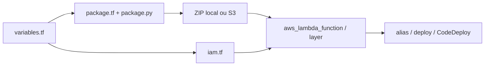

# terraform-aws-modules/terraform-aws-lambda

> Module Terraform qui construit, empaquette et déploie fonctions et layers AWS Lambda.

## Le problème
Déployer une Lambda avec ses dépendances, son IAM, ses alias et ses déclencheurs demande beaucoup de ressources Terraform et un packaging à la main.

## Ce que ça fait vraiment
Un `package.py` calcule un hash du contenu, installe les dépendances (pip, poetry, npm, commandes, Docker) et crée le zip seulement quand nécessaire. Le module crée fonction ou layer, rôle IAM et politiques, logs CloudWatch, permissions de déclencheurs, event source mappings, function URL, concurrence. Sous-modules alias, deploy (CodeDeploy) et docker-build. Supporte zip local, S3 ou image ECR.

## Comment c'est branché


## Essayer
```bash
export TF_LAMBDA_PACKAGE_LOG_LEVEL=DEBUG2
terraform apply
sam local invoke --hook-name terraform module.hello_world_function.aws_lambda_function.this[0]
sam sync --hook-name terraform --watch
```

## Coût et pièges
Lambda, S3 et CloudWatch facturés par AWS. Python 3.6+ requis sur le poste (absent des workers Terraform Cloud par défaut). Des archives concurrentes de même source se corrompent sans `hash_extra`. Le README contient une publicité pour compliance.tf, produit du mainteneur.

## Ce que ce n'est pas
Pas un framework serverless applicatif : un module d'infrastructure. Certaines demandes (`lifecycle` dynamique) sont hors de portée de Terraform.

## Alternatives
- AWS SAM CLI : cité pour le test local, complémentaire.

## Pour toi
À adopter pour déployer des endpoints d'inférence ou des tâches légères sur Lambda en IaC ; mainteneur principal unique, mais très utilisé et à jour.

