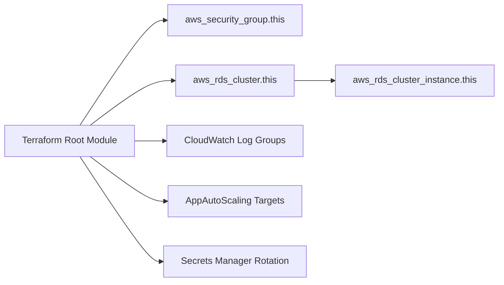

# terraform-aws-modules/terraform-aws-rds-aurora

> Terraform module that creates AWS RDS Aurora clusters with networking, security, monitoring and autoscaling.

## The problem
An Aurora cluster requires assembling the cluster, instances, parameter groups, security, a monitoring role and secret rotation.

## What it actually does
The module creates the cluster and its instances (writer and readers, heterogeneous classes possible), the parameter and subnet groups, the security group, the CloudWatch logs and the monitoring role. It handles read replica autoscaling, global clusters, serverless v1 and v2, import from S3, custom endpoints, Aurora Limitless, DSQL and master password rotation.

## How it is wired


## Trying it
```hcl
module "cluster" {
  source  = "terraform-aws-modules/rds-aurora/aws"
  name           = "test-aurora-db-postgres96"
  engine         = "aurora-postgresql"
  engine_version = "17.5"
  cluster_instance_class = "db.r8g.large"
  instances = { one = {} two = { instance_class = "db.r8g.2xlarge" } }
}
```

## Cost and gotchas
Aurora instances are billed by AWS. Prerequisites: Terraform 1.11.1 or later and AWS provider 6.61 or later. To avoid data loss: `deletion_protection = true` and a final snapshot.

## What it is not
Not a database administration tool: it only provisions. The README promotes compliance.tf, a service from the maintainer.

## Alternatives
The README names no alternative.

## For you
Watch: useful if your application database or feature store is on Aurora, otherwise irrelevant.
