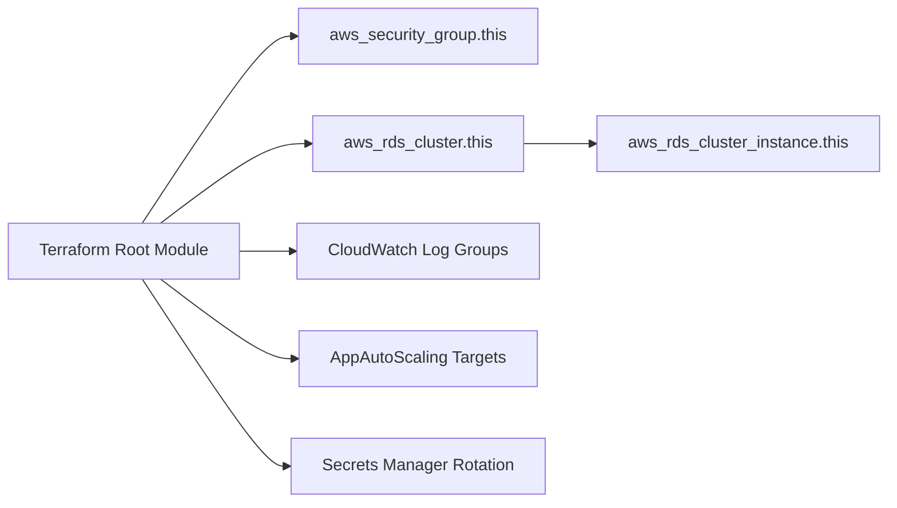

# terraform-aws-modules/terraform-aws-rds-aurora

> Module Terraform qui crée des clusters AWS RDS Aurora avec réseau, sécurité, monitoring et autoscaling.

## Le problème
Un cluster Aurora demande cluster, instances, groupes de paramètres, sécurité, rôle de monitoring et rotation des secrets à assembler.

## Ce que ça fait vraiment
Le module crée le cluster et ses instances (writer et readers, classes hétérogènes possibles), les groupes de paramètres et de sous-réseaux, le groupe de sécurité, les logs CloudWatch et le rôle de monitoring. Il gère l'autoscaling des réplicas de lecture, les clusters globaux, serverless v1 et v2, l'import depuis S3, les endpoints personnalisés, Aurora Limitless, DSQL et la rotation du mot de passe maître.

## Comment c'est branché


## Essayer
```hcl
module "cluster" {
  source  = "terraform-aws-modules/rds-aurora/aws"
  name           = "test-aurora-db-postgres96"
  engine         = "aurora-postgresql"
  engine_version = "17.5"
  cluster_instance_class = "db.r8g.large"
  instances = { one = {} two = { instance_class = "db.r8g.2xlarge" } }
}
```

## Coût et pièges
Instances Aurora facturées par AWS. Prérequis : Terraform 1.11.1 ou plus et provider AWS 6.61 ou plus. Pour éviter la perte de données : `deletion_protection = true` et snapshot final.

## Ce que ce n'est pas
Pas un outil d'administration de base : il provisionne seulement. Le README promeut compliance.tf, service du mainteneur.

## Alternatives
Le README ne nomme pas d'alternative.

## Pour toi
Surveiller : utile si ta base applicative ou ton feature store est sur Aurora, sinon sans objet.

