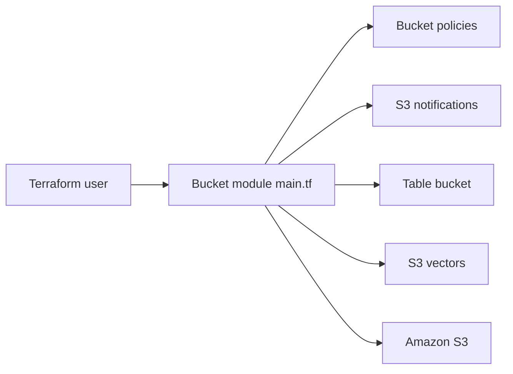

# terraform-aws-modules/terraform-aws-s3-bucket

> Terraform module that creates S3 buckets and their policies, including Iceberg tables and vectors.

## The problem
A safe S3 bucket requires about ten linked resources (encryption, public access, versioning, policies, logs) that are easy to forget.

## What it actually does
The root module covers general-purpose or directory buckets, versioning, CORS, lifecycle, encryption, object locking, replication, website hosting and log delivery policies. Submodules handle notifications, objects, Iceberg table buckets, vector buckets, S3 Files file systems and account-level public access blocking.

## How it is wired


## Trying it
```hcl
module "s3_bucket" {
  source = "terraform-aws-modules/s3-bucket/aws"
  bucket = "my-s3-bucket"
  acl    = "private"
  control_object_ownership = true
  object_ownership         = "ObjectWriter"
  versioning = { enabled = true }
}
```

## Cost and gotchas
Free module; S3 storage and requests are billed by AWS. `prevent_destroy` and `ignore_changes` cannot be passed through a module input (a Terraform limitation). An S3 Files file system requires versioning and encryption.

## What it is not
Not a data management tool: it creates the storage infrastructure. The README also promotes compliance.tf, a service from the maintainer.

## Alternatives
The README does not name an alternative.

## For you
Adopt: if your datasets and model artifacts are on S3, this module avoids configuration mistakes and already handles Iceberg tables and vectors.
