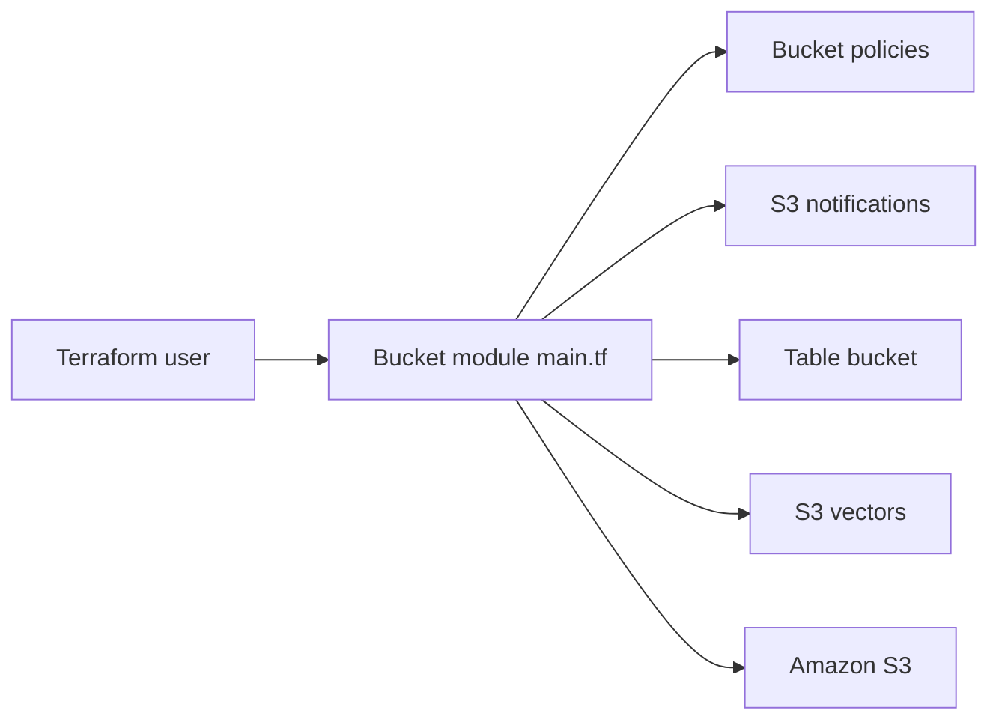

# terraform-aws-modules/terraform-aws-s3-bucket

> Module Terraform qui crée des buckets S3 et leurs politiques, y compris tables Iceberg et vecteurs.

## Le problème
Un bucket S3 sûr demande une dizaine de ressources liées (chiffrement, accès public, versioning, politiques, logs) qu'on oublie facilement.

## Ce que ça fait vraiment
Le module racine couvre bucket général ou répertoire, versioning, CORS, cycle de vie, chiffrement, verrouillage d'objets, réplication, hébergement de site et politiques de livraison de logs. Des sous-modules gèrent les notifications, les objets, les buckets de tables Iceberg, les buckets de vecteurs, les systèmes de fichiers S3 Files et le blocage d'accès public du compte.

## Comment c'est branché


## Essayer
```hcl
module "s3_bucket" {
  source = "terraform-aws-modules/s3-bucket/aws"
  bucket = "my-s3-bucket"
  acl    = "private"
  control_object_ownership = true
  object_ownership         = "ObjectWriter"
  versioning = { enabled = true }
}
```

## Coût et pièges
Module gratuit, stockage et requêtes S3 facturés par AWS. `prevent_destroy` et `ignore_changes` ne peuvent pas passer par une entrée du module (limite de Terraform). Un système de fichiers S3 Files exige versioning et chiffrement.

## Ce que ce n'est pas
Pas un outil de gestion de données : il crée l'infrastructure de stockage. Le README fait aussi la promotion de compliance.tf, service du mainteneur.

## Alternatives
Le README ne nomme pas d'alternative.

## Pour toi
Adopter : si tes jeux de données et artefacts de modèles sont sur S3, ce module évite les erreurs de configuration et gère déjà les tables Iceberg et les vecteurs.

