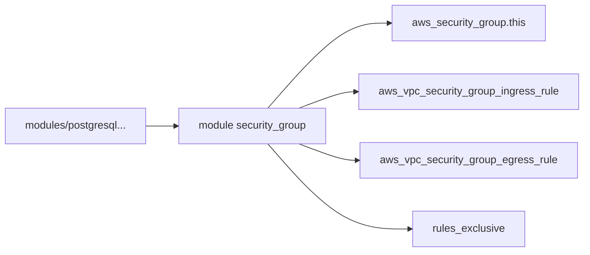

# terraform-aws-modules/terraform-aws-security-group

> Terraform module creating an EC2 security group in an AWS VPC, with declarative rules.

## The problem
Writing security groups and repetitive rules by hand is verbose and prone to drift.

## What it actually does
A root module taking `ingress_rules` and `egress_rules` as maps, and predefined per-service submodules (PostgreSQL, Consul, Cassandra…). Exclusive mode is enabled by default: rules added outside Terraform are removed at the next apply. `"self"` reference for internal traffic.

## How it is wired


## Trying it
```bash
# Bloc HCL dans le README :
# module "security_group" { source = "terraform-aws-modules/security-group/aws" ... }
```

## Cost and gotchas
Free module, AWS resources are at your expense. Terraform 1.5.7 or later, aws provider 6.29 or later. Static name with `use_name_prefix = false`: replacement fails.

## What it is not
Not an application firewall: it only manages security groups. Exclusive mode overwrites manual rules.

## Alternatives
The README does not name an alternative.

## For you
Watch: a clean building block for MLOps on AWS; check the license, which GitHub did not identify.
