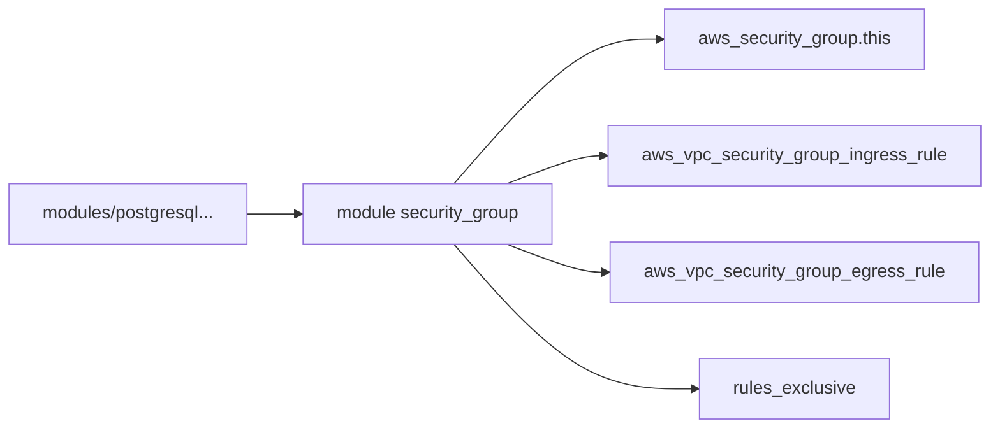

# terraform-aws-modules/terraform-aws-security-group

> Module Terraform créant un groupe de sécurité EC2 dans un VPC AWS, avec règles déclaratives.

## Le problème
Écrire à la main groupes de sécurité et règles répétitives est verbeux et sujet aux dérives.

## Ce que ça fait vraiment
Un module racine prenant `ingress_rules` et `egress_rules` sous forme de maps, et des sous-modules prédéfinis par service (PostgreSQL, Consul, Cassandra…). Mode exclusif activé par défaut : les règles ajoutées hors Terraform sont supprimées au prochain apply. Référence `"self"` pour le trafic interne.

## Comment c'est branché


## Essayer
```bash
# Bloc HCL dans le README :
# module "security_group" { source = "terraform-aws-modules/security-group/aws" ... }
```

## Coût et pièges
Module gratuit, ressources AWS à ta charge. Terraform 1.5.7 ou plus, provider aws 6.29 ou plus. Nom statique avec `use_name_prefix = false` : le remplacement échoue.

## Ce que ce n'est pas
Pas un pare-feu applicatif : il ne gère que les groupes de sécurité. Le mode exclusif écrase les règles manuelles.

## Alternatives
Le README ne nomme pas d'alternative.

## Pour toi
À surveiller : brique propre pour un MLOps sur AWS ; vérifie la licence non identifiée par GitHub.

