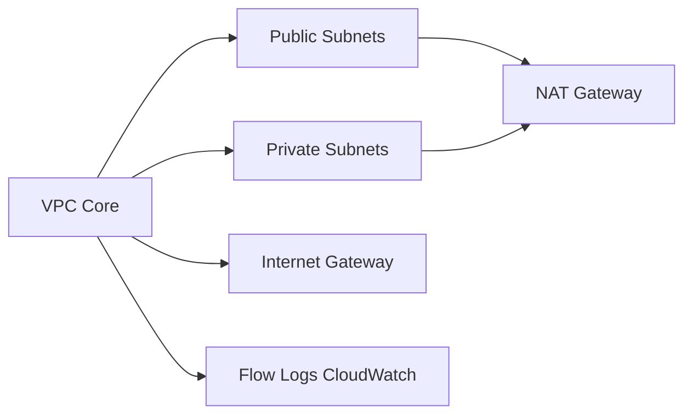

# terraform-aws-modules/terraform-aws-vpc

> Terraform module that creates a complete AWS VPC, with subnets, NAT and ACLs, for infrastructure teams.

## The problem
Describing a VPC, subnets, routes, gateways and ACLs by hand is slow and error-prone.

## What it actually does
A single module creates the VPC, subnets (public, private, intra, database, Redshift, ElastiCache, Outposts), Internet Gateway, NAT (one per subnet, per zone or a single one), VPN, route tables, network ACLs, Flow Logs, IPAM and IPv6. Many variables per subnet type.

## How it is wired


## Trying it
```hcl
module "vpc" {
  source = "terraform-aws-modules/vpc/aws"
  name = "my-vpc"
  cidr = "10.0.0.0/16"
  azs             = ["eu-west-1a", "eu-west-1b", "eu-west-1c"]
  private_subnets = ["10.0.1.0/24", "10.0.2.0/24", "10.0.3.0/24"]
  public_subnets  = ["10.0.101.0/24", "10.0.102.0/24", "10.0.103.0/24"]
  enable_nat_gateway = true
}
```

## Cost and gotchas
AWS account required; NAT Gateways and Elastic IPs are billed. Terraform ≥ 1.0, aws provider ≥ 6.28. The Flow Logs built into the root module will be removed in v7.0.0. The README promotes compliance.tf (a service of the maintainer).

## What it is not
Not a solution to Terraform's limitations (literal `lifecycle`, removed tags). A VPC does not include application security.

## Alternatives
- Standalone Flow Logs module: to be used instead of the one in the root module.

## For you
Worth watching: a reference for describing the network of an ML platform on AWS, provided you keep NAT costs under control.
