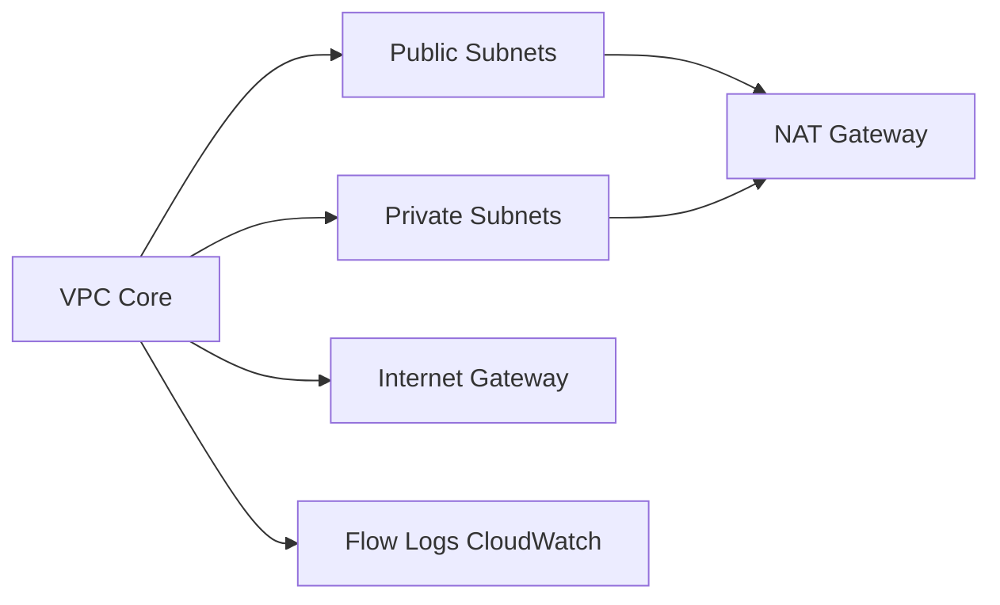

# terraform-aws-modules/terraform-aws-vpc

> Module Terraform qui crée un VPC AWS complet, avec sous-réseaux, NAT et ACL, pour équipes d'infrastructure.

## Le problème
Décrire à la main VPC, sous-réseaux, routes, passerelles et ACL est long et sujet aux erreurs.

## Ce que ça fait vraiment
Un seul module crée VPC, sous-réseaux (publics, privés, intra, base de données, Redshift, ElastiCache, Outposts), Internet Gateway, NAT (un par sous-réseau, par zone ou unique), VPN, tables de routage, ACL réseau, Flow Logs, IPAM et IPv6. De nombreuses variables par type de sous-réseau.

## Comment c'est branché


## Essayer
```hcl
module "vpc" {
  source = "terraform-aws-modules/vpc/aws"
  name = "my-vpc"
  cidr = "10.0.0.0/16"
  azs             = ["eu-west-1a", "eu-west-1b", "eu-west-1c"]
  private_subnets = ["10.0.1.0/24", "10.0.2.0/24", "10.0.3.0/24"]
  public_subnets  = ["10.0.101.0/24", "10.0.102.0/24", "10.0.103.0/24"]
  enable_nat_gateway = true
}
```

## Coût et pièges
Compte AWS ; les NAT Gateways et IP élastiques sont facturés. Terraform ≥ 1.0, fournisseur aws ≥ 6.28. Les Flow Logs intégrés au module racine seront retirés en v7.0.0. Le README fait la promotion de compliance.tf (service du mainteneur).

## Ce que ce n'est pas
Pas une solution aux limites de Terraform (`lifecycle` littéral, balises retirées). Un VPC n'inclut pas la sécurité applicative.

## Alternatives
- Module standalone de Flow Logs : à utiliser plutôt que celui du module racine.

## Pour toi
À surveiller : référence pour décrire le réseau d'une plateforme ML sur AWS, à condition de maîtriser le coût des NAT.

