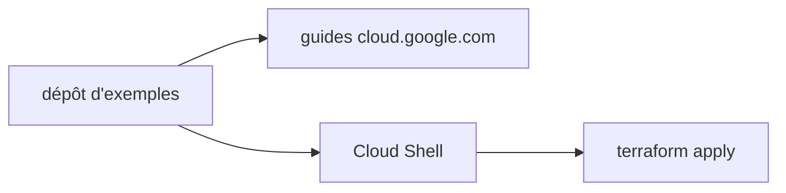

# terraform-google-modules/terraform-docs-samples

> Terraform examples intended for the Google Cloud documentation, to be run in Cloud Shell.

## The problem
The Google Cloud documentation needs reliable, consistent, ready-to-test Terraform snippets.

## What it actually does
Gathers the Terraform examples used in the tabs of the cloud.google.com guides. The README only gives the recommended way to run them (Cloud Shell, automatic authentication), the style guideline for contributions and the feedback channels.

## How it is wired
Simplified diagram based on the sheet, no diagram provided.



## Trying it
```bash
git clone https://github.com/terraform-google-modules/terraform-docs-samples
```

## Cost and gotchas
Google Cloud account required. Resources created by an example are billed to you.

## What it is not
Not a reusable module: these are examples for documentation, not a versioned production library.

## Alternatives
No alternative named in the README.

## For you
Ignore: serves as an occasional reference if you deploy on Google Cloud with Terraform, nothing specific to data or AI.
