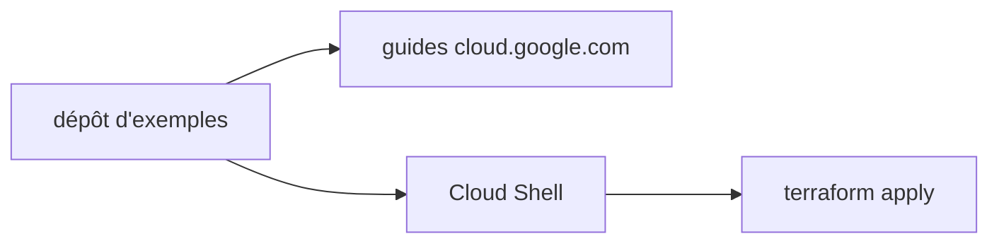

# terraform-google-modules/terraform-docs-samples

> Exemples Terraform destinés à la documentation Google Cloud, à exécuter dans Cloud Shell.

## Le problème
La documentation Google Cloud a besoin d'extraits Terraform fiables, cohérents et prêts à tester.

## Ce que ça fait vraiment
Rassemble les exemples Terraform repris dans les onglets des guides de cloud.google.com. Le README donne seulement le mode d'exécution recommandé (Cloud Shell, authentification automatique), la consigne de style pour les contributions et les canaux de retour.

## Comment c'est branché
Schéma simplifié d'après la fiche, sans diagramme fourni.



## Essayer
```bash
git clone https://github.com/terraform-google-modules/terraform-docs-samples
```

## Coût et pièges
Compte Google Cloud requis. Les ressources créées par un exemple sont facturées à ta charge.

## Ce que ce n'est pas
Pas un module réutilisable : ce sont des exemples pour la documentation, pas une bibliothèque versionnée de production.

## Alternatives
Aucune alternative nommée dans le README.

## Pour toi
Ignorer : sert de référence ponctuelle si tu déploies sur Google Cloud avec Terraform, rien de propre à la data ou à l'IA.

