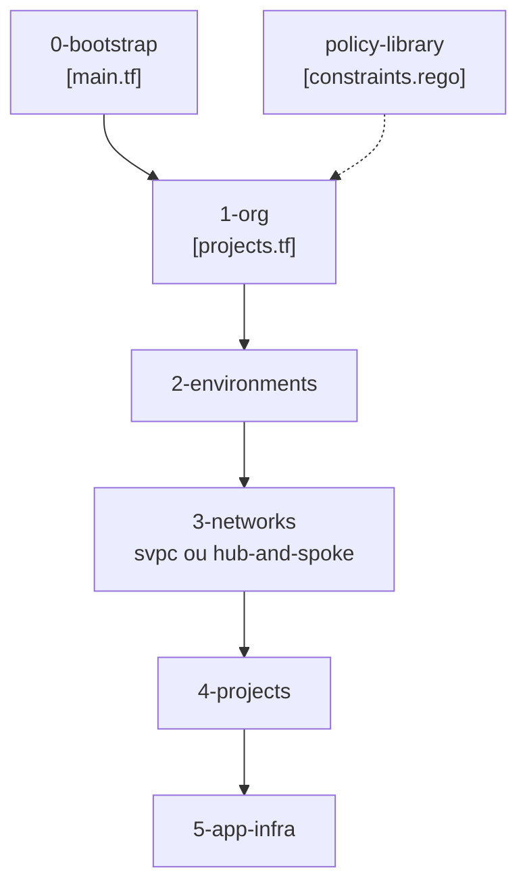

# terraform-google-modules/terraform-example-foundation

> Terraform template for building a secure Google Cloud foundation, intended for large enterprises with a platform team.

## The problem
Setting up a Google Cloud organization by hand, with role separation, logging, networking and IaC pipelines, is slow and prone to security mistakes.

## What it actually does
Root Terraform projects, to be applied in order: 0-bootstrap (seed and CI/CD projects, service accounts), 1-org (folders, logs, Security Command Center, KMS, secrets), 2-environments, 3-networks (shared VPC or hub-and-spoke), 4-projects, 5-app-infra. Plans are validated by an OPA policy library. A production-only mode reduces the footprint by about 60%.

## How it is wired


## Trying it
```bash
terraform init
terraform apply
```
The 0-bootstrap step is run by hand, the following ones via Cloud Build. For production only: `production_only_deploy = true` in `global.tfvars`.

## Cost and gotchas
A Google Cloud account with an existing organization, billing at your expense for all the projects created. To be forked and adapted: it is not a turnkey product.

## What it is not
It is not a solution for small organizations: the README points them to Google Cloud Setup. BigQuery billing must be configured by hand.

## Alternatives
- Google Cloud Setup: a simpler option for small organizations, cited in the README.

## For you
Worth watching: relevant only if you must set up a governed GCP platform to host MLOps; too heavy for an isolated project.
