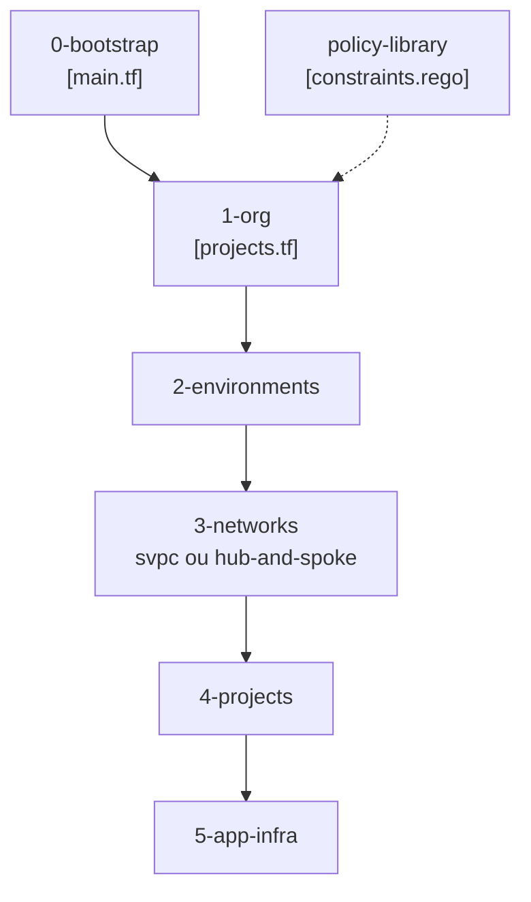

# terraform-google-modules/terraform-example-foundation

> Modèle Terraform pour bâtir une fondation Google Cloud sécurisée, destiné aux grandes entreprises avec une équipe plateforme.

## Le problème
Monter une organisation Google Cloud avec séparation des rôles, journalisation, réseau et pipelines IaC à la main est long et source d'erreurs de sécurité.

## Ce que ça fait vraiment
Des projets Terraform racines, à appliquer dans l'ordre : 0-bootstrap (projets seed et CI/CD, comptes de service), 1-org (dossiers, journaux, Security Command Center, KMS, secrets), 2-environments, 3-networks (VPC partagé ou hub-and-spoke), 4-projects, 5-app-infra. Les plans sont validés par une bibliothèque de politiques OPA. Un mode production seule réduit l'empreinte d'environ 60 %.

## Comment c'est branché


## Essayer
```bash
terraform init
terraform apply
```
L'étape 0-bootstrap se lance à la main, les suivantes via Cloud Build. Pour la production seule : `production_only_deploy = true` dans `global.tfvars`.

## Coût et pièges
Compte Google Cloud avec une organisation existante, facturation à ta charge pour tous les projets créés. À forker et adapter : ce n'est pas un produit clé en main.

## Ce que ce n'est pas
Ce n'est pas une solution pour petites structures : le README les renvoie vers Google Cloud Setup. La facturation BigQuery doit être configurée à la main.

## Alternatives
- Google Cloud Setup : option plus simple pour les petites organisations, citée dans le README.

## Pour toi
À surveiller : pertinent seulement si tu dois mettre en place une plateforme GCP gouvernée pour héberger du MLOps ; trop lourd pour un projet isolé.

