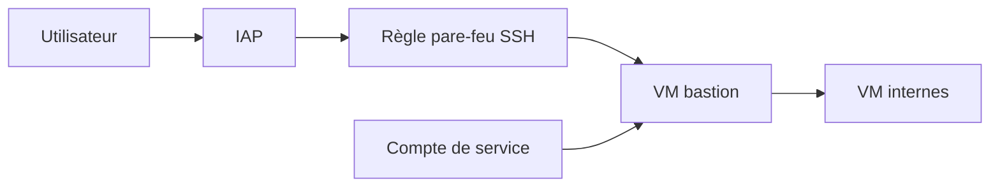

# terraform-google-modules/terraform-google-bastion-host

> Terraform module that deploys a Google Cloud bastion VM reachable through OS Login and IAP.

## The problem
Accessing internal VMs without exposing SSH to the public means setting up a service account, firewall and IAM rights by hand.

## What it actually does
Creates a dedicated service account, a GCE bastion instance, a firewall rule allowing TCP:22 from IAP and the IAM rights for IAP and OS Login. The module does not grant users access: you must assign them an OS Login role. Debian 12 image by default.

## How it is wired
Simplified diagram based on the sheet, no diagram provided.



## Trying it
```bash
# Usage décrit dans le README, en HCL :
# module "iap_bastion" { source = "terraform-google-modules/bastion-host/google" ... }
```

## Cost and gotchas
GCE billing is on you (n1-standard-1 machine by default). You need a project with four APIs enabled and Terraform 1.3 or later.

## What it is not
Not a VPN nor an access solution managing users: only the bastion's service account is configured. No support for other clouds.

## Alternatives
No alternative named in the README.

## For you
Ignore unless you administer SSH access for a GCP project yourself: an infrastructure building block with no direct link to data or AI.
