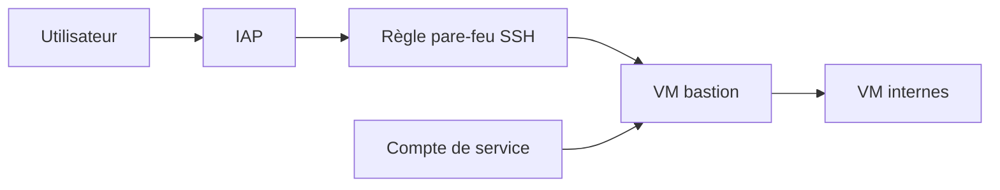

# terraform-google-modules/terraform-google-bastion-host

> Module Terraform qui déploie une VM bastion Google Cloud accessible via OS Login et IAP.

## Le problème
Accéder à des VM internes sans ouvrir SSH au public demande de monter à la main compte de service, pare-feu et droits IAM.

## Ce que ça fait vraiment
Crée un compte de service dédié, une instance GCE bastion, une règle de pare-feu autorisant TCP:22 depuis IAP et les droits IAM pour IAP et OS Login. Le module ne donne pas d'accès aux utilisateurs : il faut leur attribuer un rôle OS Login. Image Debian 12 par défaut.

## Comment c'est branché
Schéma simplifié d'après la fiche, sans diagramme fourni.



## Essayer
```bash
# Usage décrit dans le README, en HCL :
# module "iap_bastion" { source = "terraform-google-modules/bastion-host/google" ... }
```

## Coût et pièges
Facturation GCE à ta charge (machine n1-standard-1 par défaut). Il faut un projet avec quatre API activées et Terraform 1.3 ou plus.

## Ce que ce n'est pas
Pas un VPN ni une solution d'accès gérant les utilisateurs : seul le compte de service du bastion est configuré. Pas de support d'autres clouds.

## Alternatives
Aucune alternative nommée dans le README.

## Pour toi
À ignorer sauf si tu administres toi-même l'accès SSH d'un projet GCP : brique d'infrastructure sans lien direct avec la donnée ou l'IA.

