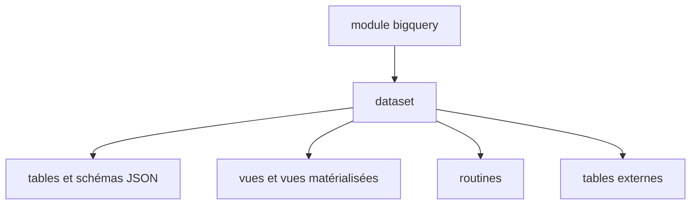

# terraform-google-modules/terraform-google-bigquery

> Terraform module to create BigQuery datasets with tables, views, routines and external tables, as code.

## The problem
Creating BigQuery datasets, partitioned tables and views by hand makes environments hard to reproduce.

## What it actually does
A single module that provisions a dataset and a list of tables with JSON schemas, time-based or range partitioning, clustering, views, materialized views, routines and external tables. Access rights and encryption key are configurable. It only creates the empty schema.

## How it is wired
Simplified diagram based on the fiche, no diagram provided.


## Trying it
```bash
# Bloc HCL du README
# module "bigquery" {
#   source  = "terraform-google-modules/bigquery/google"
#   version = "~> 10.2"
#   dataset_id = "foo"
#   project_id = "<PROJECT ID>"
#   location   = "US"
# }
```

## Cost and gotchas
Needs a service account with `roles/bigquery.dataOwner` and the BigQuery API enabled. BigQuery storage and queries are billed by Google.

## What it is not
Not a data loading or querying tool. Accounts that query the tables must be granted their rights separately.

## Alternatives
Not documented in the README.

## For you
Worth watching: useful for versioning your BigQuery warehouse if you are on GCP and Terraform, otherwise off-topic.
