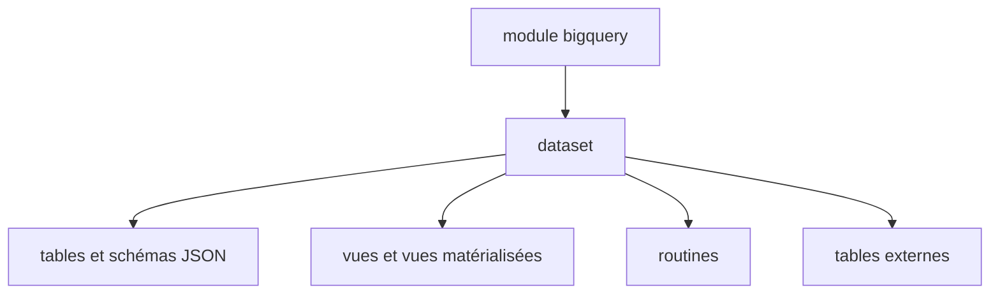

# terraform-google-modules/terraform-google-bigquery

> Module Terraform pour créer des datasets BigQuery avec tables, vues, routines et tables externes, par le code.

## Le problème
Créer à la main datasets, tables partitionnées et vues BigQuery rend les environnements difficiles à reproduire.

## Ce que ça fait vraiment
Un seul module qui provisionne un dataset et une liste de tables avec schémas JSON, partitionnement temporel ou par plage, clustering, vues, vues matérialisées, routines et tables externes. Droits d'accès et clé de chiffrement réglables. Ne crée que le schéma vide.

## Comment c'est branché
Schéma simplifié d'après la fiche, sans diagramme fourni.


## Essayer
```bash
# Bloc HCL du README
# module "bigquery" {
#   source  = "terraform-google-modules/bigquery/google"
#   version = "~> 10.2"
#   dataset_id = "foo"
#   project_id = "<PROJECT ID>"
#   location   = "US"
# }
```

## Coût et pièges
Compte de service avec `roles/bigquery.dataOwner` et API BigQuery activée. Le stockage et les requêtes BigQuery sont facturés par Google.

## Ce que ce n'est pas
Pas un outil de chargement de données ni de requêtes. Les comptes qui interrogent les tables doivent recevoir leurs droits à part.

## Alternatives
Non documenté dans le README.

## Pour toi
À surveiller : utile pour versionner ton entrepôt BigQuery si tu es sur GCP et Terraform, sinon hors sujet.

