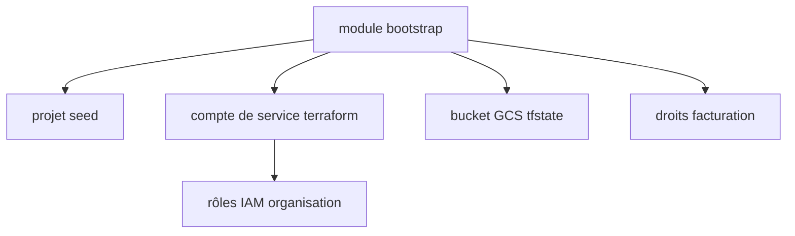

# terraform-google-modules/terraform-google-bootstrap

> Terraform module that prepares a GCP organization (seed project, service account, state bucket) for the Cloud Foundation Toolkit.

## The problem
Starting a GCP organization by hand: project, IAM permissions, billing, Terraform state storage. It is long and easy to get wrong.

## What it actually does
Creates a seed project, enables the APIs, creates a Terraform service account and a GCS bucket for the state. Grants organization and billing IAM roles to the admin groups. Optional service account impersonation. A cloudbuild submodule exists.

## How it is wired
Simplified diagram based on the sheet, no diagram provided.


## Trying it
```bash
# Bloc HCL du README
# module "bootstrap" {
#   source  = "terraform-google-modules/bootstrap/google"
#   version = "~> 13.0"
#   org_id = "<ORGANIZATION_ID>"
#   billing_account = "<BILLING_ACCOUNT_ID>"
#   group_org_admins = "gcp-organization-admins@example.com"
#   group_billing_admins = "gcp-billing-admins@example.com"
# }
```

## Cost and gotchas
Requires the organizationAdmin, policyAdmin and billing.admin roles. Overwrites the project-creation roles at the organization level: not being in `group_org_admins` loses you access.

## What it is not
Not a tool for a single isolated GCP project: it acts on the whole organization. The GCP resources created remain billed by Google.

## Alternatives
Not documented in the README.

## For you
Worth watching: useful only if you are building a GCP foundation for a data or MLOps platform, otherwise off topic.
