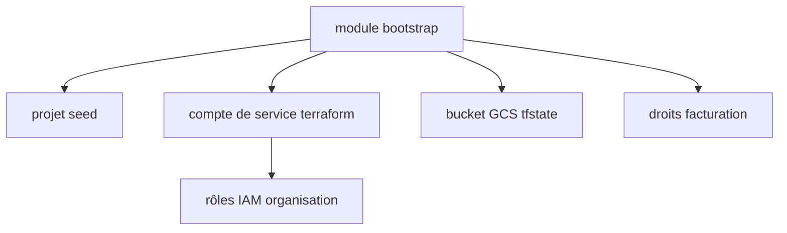

# terraform-google-modules/terraform-google-bootstrap

> Module Terraform qui prépare une organisation GCP (projet seed, compte de service, bucket d'état) pour le Cloud Foundation Toolkit.

## Le problème
Démarrer une organisation GCP à la main : projet, droits IAM, facturation, stockage de l'état Terraform. C'est long et facile à rater.

## Ce que ça fait vraiment
Crée un projet seed, active les API, crée un compte de service Terraform et un bucket GCS pour l'état. Accorde les rôles IAM d'organisation et de facturation aux groupes admins. Option d'usurpation du compte de service. Un sous-module cloudbuild existe.

## Comment c'est branché
Schéma simplifié d'après la fiche, sans diagramme fourni.


## Essayer
```bash
# Bloc HCL du README
# module "bootstrap" {
#   source  = "terraform-google-modules/bootstrap/google"
#   version = "~> 13.0"
#   org_id = "<ORGANIZATION_ID>"
#   billing_account = "<BILLING_ACCOUNT_ID>"
#   group_org_admins = "gcp-organization-admins@example.com"
#   group_billing_admins = "gcp-billing-admins@example.com"
# }
```

## Coût et pièges
Exige des rôles organisationAdmin, policyAdmin et billing.admin. Écrase les rôles de création de projet à l'échelle de l'organisation : n'être pas dans `group_org_admins` fait perdre l'accès.

## Ce que ce n'est pas
Pas un outil pour un projet GCP isolé : il agit sur toute l'organisation. Les ressources GCP créées restent facturées par Google.

## Alternatives
Non documenté dans le README.

## Pour toi
À surveiller : utile seulement si tu montes une fondation GCP pour une plateforme data ou MLOps, sinon hors sujet.

