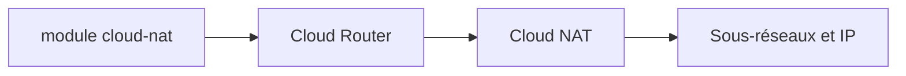

# terraform-google-modules/terraform-google-cloud-nat

> Terraform module that creates and configures a Google Cloud NAT; the author recommends the Cloud Router module instead.

## The problem
Giving outbound Internet access to GCP machines without public IPs requires a precise NAT configuration.

## What it actually does
Creates a Cloud NAT on an existing router (or creates one), with options for ports per VM, dynamic allocation, TCP/UDP/ICMP idle timeouts, logs, rules and subnet ranges. IPs can be automatic or fixed.

## How it is wired
Simplified diagram based on the sheet, no diagram provided.


## Trying it
```bash
terraform init
terraform plan
terraform apply
terraform destroy
```

## Cost and gotchas
GCP account, `roles/compute.networkAdmin` role, Compute Engine API enabled. Several changes (ports, IPs, timeouts) force recreation of the NAT. The Terraform version in the README is old (0.13+).

## What it is not
Not the recommended module: the README points to the Cloud Router module, which is more flexible.

## Alternatives
- Cloud Router module from terraform-google-modules: more flexible, also handles interconnects.

## For you
Ignore: the author himself advises against it in favor of the Cloud Router module, and it is network plumbing.
