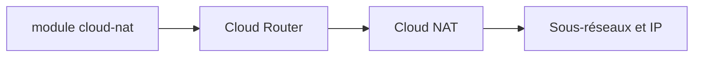

# terraform-google-modules/terraform-google-cloud-nat

> Module Terraform qui crée et configure un Cloud NAT Google Cloud ; l'auteur recommande plutôt le module Cloud Router.

## Le problème
Donner un accès sortant à Internet à des machines GCP sans IP publique demande une configuration NAT précise.

## Ce que ça fait vraiment
Crée un Cloud NAT sur un routeur existant (ou en crée un), avec options de ports par VM, allocation dynamique, délais d'inactivité TCP/UDP/ICMP, journaux, règles et plages de sous-réseaux. Les IP peuvent être automatiques ou fixes.

## Comment c'est branché
Schéma simplifié d'après la fiche, sans diagramme fourni.


## Essayer
```bash
terraform init
terraform plan
terraform apply
terraform destroy
```

## Coût et pièges
Compte GCP, rôle `roles/compute.networkAdmin`, API Compute Engine activée. Plusieurs changements (ports, IP, délais) forcent la recréation du NAT. La version de Terraform du README est ancienne (0.13+).

## Ce que ce n'est pas
Pas le module recommandé : le README oriente vers le module Cloud Router, plus flexible.

## Alternatives
- Module Cloud Router de terraform-google-modules : plus flexible, gère aussi les interconnexions.

## Pour toi
Ignorer : l'auteur lui-même le déconseille au profit du module Cloud Router, et c'est de la plomberie réseau.

