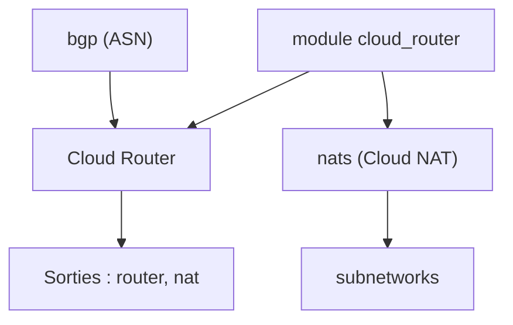

# terraform-google-modules/terraform-google-cloud-router

> Terraform module to create a Google Cloud Router and, optionally, Cloud NAT gateways.

## The problem
Configuring a BGP router and its NATs on GCP by hand is repetitive and error-prone.

## What it actually does
The module creates a Cloud Router with its BGP configuration (ASN, advertise mode, ranges) and optional NATs. The NATs accept many settings: ports per VM, idle timeouts, subnetworks. Cloud NAT logging is enabled by default with the ALL filter. It exposes the router and the NATs as outputs.

## How it is wired

## Trying it
No command documented in the provided README, apart from the example module block.

## Cost and gotchas
You need a service account with roles/compute.networkAdmin and the Compute Engine API enabled. NAT logging being enabled by default can generate a large volume of logs.

## What it is not
It is not a complete networking module: it creates neither a VPC nor subnetworks, only the router and its NATs. Examples are in the examples folder.

## Alternatives
- No alternative named in the README.

## For you
Ignore: a GCP networking building block, useful only to someone building a VPC in Terraform.
