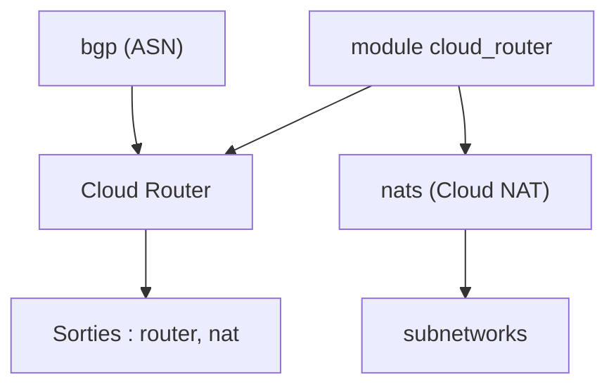

# terraform-google-modules/terraform-google-cloud-router

> Module Terraform pour créer un Cloud Router Google Cloud et, en option, des passerelles Cloud NAT.

## Le problème
Configurer un routeur BGP et ses NAT sur GCP à la main est répétitif et sujet aux erreurs.

## Ce que ça fait vraiment
Le module crée un Cloud Router avec sa configuration BGP (ASN, mode d'annonce, plages) et des NAT optionnels. Les NAT acceptent de nombreux réglages : ports par VM, délais d'inactivité, sous-réseaux. La journalisation de Cloud NAT est activée par défaut avec le filtre ALL. Il expose le routeur et les NAT en sortie.

## Comment c'est branché

## Essayer
Aucune commande documentée dans le README fourni, hors l'exemple de bloc module.

## Coût et pièges
Il faut un compte de service avec roles/compute.networkAdmin et l'API Compute Engine activée. La journalisation NAT activée par défaut peut générer du volume de logs.

## Ce que ce n'est pas
Ce n'est pas un module de réseau complet : il ne crée ni VPC ni sous-réseaux, seulement le routeur et ses NAT. Les exemples sont dans le dossier examples.

## Alternatives
- Aucune alternative nommée dans le README.

## Pour toi
À ignorer : brique réseau GCP, utile seulement à qui construit un VPC en Terraform.

