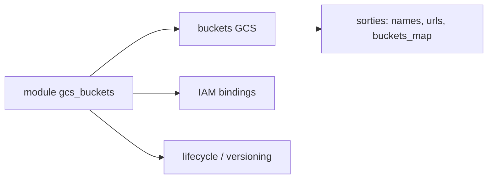

# terraform-google-modules/terraform-google-cloud-storage

> Terraform module to create Google Cloud Storage buckets with their basic IAM permissions.

## The problem
Creating several consistent buckets (versioning, lifecycle, encryption, permissions) by hand is hard to reproduce.

## What it actually does
Creates one or more GCS buckets and zero or more IAM bindings. Options: versioning, lifecycle rules, CORS, retention, soft delete, encryption keys, IP filter, HMAC (S3-compatible access), random prefix and suffix. A "simple bucket" submodule exists for a single bucket.

## How it is wired


## Trying it
```bash
# module "gcs_buckets" { source = "terraform-google-modules/cloud-storage/google" ... }
terraform init && terraform apply
```

## Cost and gotchas
GCS storage is billed. Service account with `roles/storage.admin` and the storage API enabled. `force_destroy` is false by default: check it before deleting.

## What it is not
Not a data transfer tool. GCP only.

## Alternatives
No alternative named in the README (simple bucket submodule in the same repository for a single bucket).

## For you
Watch: a classic building block for dataset and model artifact buckets on GCP.
