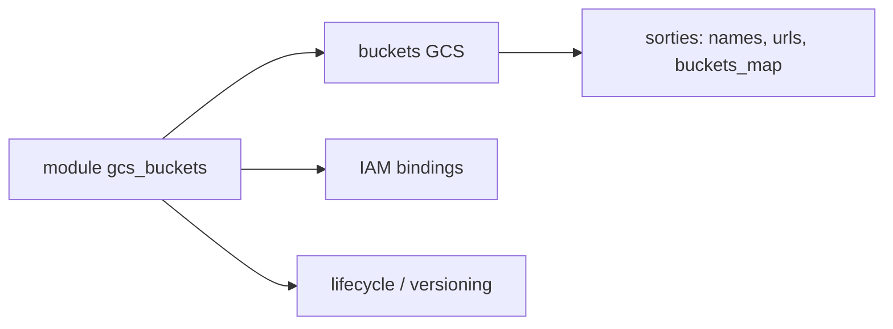

# terraform-google-modules/terraform-google-cloud-storage

> Module Terraform pour créer des buckets Google Cloud Storage avec leurs droits IAM de base.

## Le problème
Créer plusieurs buckets cohérents (versioning, cycle de vie, chiffrement, droits) à la main se reproduit mal.

## Ce que ça fait vraiment
Crée un ou plusieurs buckets GCS et zéro ou plusieurs liaisons IAM. Options : versioning, règles de cycle de vie, CORS, rétention, soft delete, clés de chiffrement, filtre IP, HMAC (accès compatible S3), préfixe et suffixe aléatoire. Un sous-module « simple bucket » existe pour un seul bucket.

## Comment c'est branché


## Essayer
```bash
# module "gcs_buckets" { source = "terraform-google-modules/cloud-storage/google" ... }
terraform init && terraform apply
```

## Coût et pièges
Stockage GCS facturé. Compte de service avec `roles/storage.admin` et API storage activée. `force_destroy` est à false par défaut : à vérifier avant suppression.

## Ce que ce n'est pas
Pas un outil de transfert de données. Seulement GCP.

## Alternatives
Aucune alternative nommée dans le README (sous-module simple bucket du même dépôt pour un seul bucket).

## Pour toi
Surveiller : brique classique pour les buckets de datasets et d'artefacts de modèles sur GCP.

