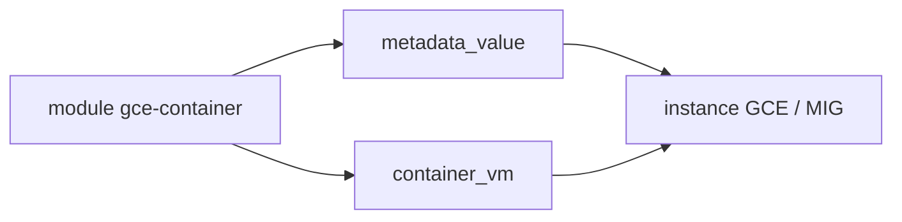

# terraform-google-modules/terraform-google-container-vm

> Deprecated Terraform module that generates the metadata needed to run a container on a GCE VM.

## The problem
Deploying a container directly on a Compute Engine VM at creation time, without an orchestrator.

## What it actually does
Generates the metadata (COS image, container, volumes, restart policy) to pass to an instance or a managed instance group; it does not launch the instance itself. The README declares the module deprecated and recommends a startup script, cloud-init, GKE or Batch.

## How it is wired


## Trying it
```bash
terraform init
terraform plan
terraform apply
```

## Cost and gotchas
Compute Engine VM is billed. The README is mostly test logs and mentions old versions (Terraform 0.10.x, provider 2.12).

## What it is not
Not an orchestrator, and no longer recommended by its authors. The instance group example has not been migrated to Terraform 0.12.

## Alternatives
- GKE or Batch, cited by the README as replacements.

## For you
Ignore: deprecated by its authors, use GKE or Batch for your containers.
