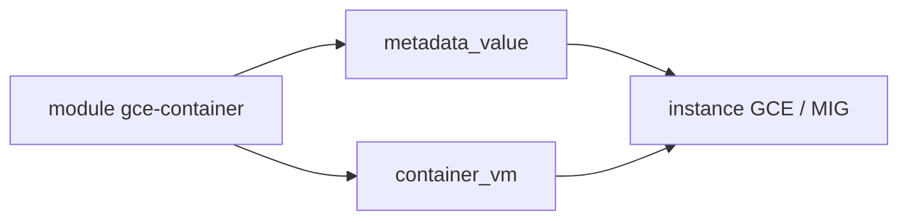

# terraform-google-modules/terraform-google-container-vm

> Module Terraform déprécié qui génère les métadonnées pour lancer un conteneur sur une VM GCE.

## Le problème
Déployer un conteneur directement sur une VM Compute Engine à la création, sans orchestrateur.

## Ce que ça fait vraiment
Génère les métadonnées (image COS, conteneur, volumes, politique de redémarrage) à passer à une instance ou un groupe d'instances géré ; il ne lance pas l'instance lui-même. Le README annonce le module déprécié et recommande un script de démarrage, cloud-init, GKE ou Batch.

## Comment c'est branché


## Essayer
```bash
terraform init
terraform plan
terraform apply
```

## Coût et pièges
VM Compute Engine facturée. Le README est très long de logs de tests et mentionne des versions anciennes (Terraform 0.10.x, provider 2.12).

## Ce que ce n'est pas
Pas un orchestrateur, et plus recommandé par ses auteurs. L'exemple de groupe d'instances n'est pas migré vers Terraform 0.12.

## Alternatives
- GKE ou Batch, cités par le README comme remplacement.

## Pour toi
Ignorer : déprécié par ses auteurs, utilise GKE ou Batch pour tes conteneurs.

