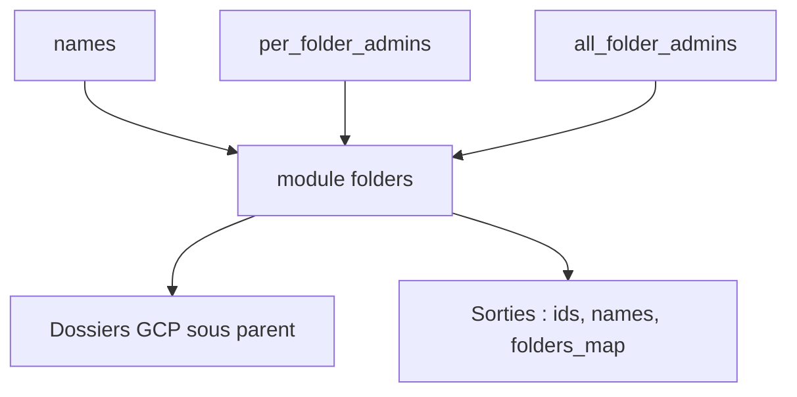

# terraform-google-modules/terraform-google-folders

> Terraform module that creates several Google Cloud folders under a single parent, with consistent permissions.

## The problem
Creating GCP folders and assigning them the same roles by hand leads to inconsistent organisations.

## What it actually does
The module creates folders from a list of names under a parent (folder or organisation). With set_roles, it assigns roles to members, per folder or for all. Deletion protection is on by default. It exposes the folder identifiers and names as outputs.

## How it is wired


## Trying it
```bash
terraform init
```
The README shows only the example module block, with no other command.

## Cost and gotchas
You need a service account with the roles/resourcemanager.folderCreator role and the Cloud Resource Manager API enabled. By default, the roles granted include roles/owner: restrict it.

## What it is not
It is not a project-creation module: for that the README points to the Project Factory. The Terraform versions cited vary across the text.

## Alternatives
- Project Factory module: to create the projects and the required APIs.

## For you
Ignore: a module useful only to someone structuring a GCP organisation in Terraform, with no direct link to data or AI.
