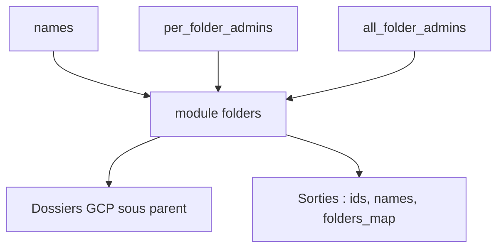

# terraform-google-modules/terraform-google-folders

> Module Terraform qui crée plusieurs dossiers Google Cloud sous un même parent, avec permissions cohérentes.

## Le problème
Créer des dossiers GCP et leur attribuer les mêmes rôles à la main donne des organisations incohérentes.

## Ce que ça fait vraiment
Le module crée des dossiers à partir d'une liste de noms sous un parent (dossier ou organisation). Avec set_roles, il attribue des rôles aux membres, par dossier ou pour tous. La protection contre la suppression est active par défaut. Il expose les identifiants et les noms des dossiers en sortie.

## Comment c'est branché


## Essayer
```bash
terraform init
```
Le README ne montre que l'exemple de bloc module, sans autre commande.

## Coût et pièges
Il faut un compte de service avec le rôle roles/resourcemanager.folderCreator et l'API Cloud Resource Manager activée. Par défaut, les rôles accordés incluent roles/owner : à restreindre.

## Ce que ce n'est pas
Ce n'est pas un module de création de projets : pour cela le README évoque le Project Factory. Les versions de Terraform citées varient dans le texte.

## Alternatives
- Project Factory module : pour créer les projets et les APIs nécessaires.

## Pour toi
À ignorer : module utile seulement à qui structure une organisation GCP en Terraform, sans lien direct avec les données ou l'IA.

