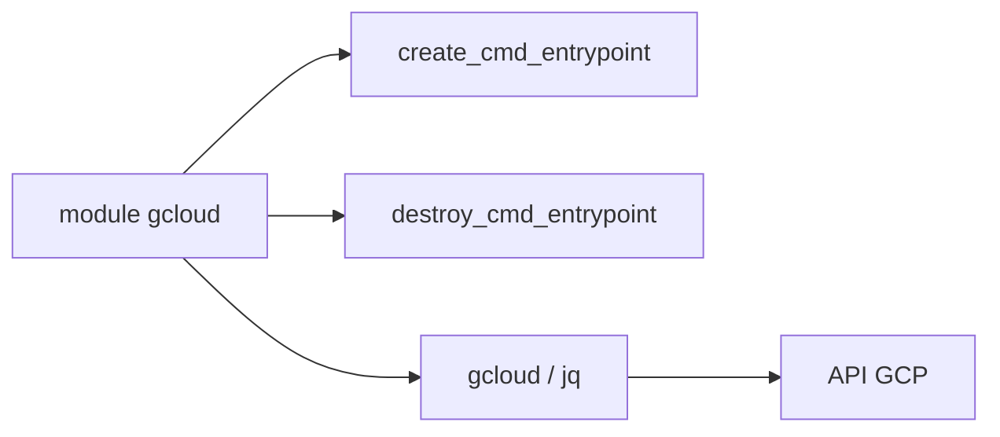

# terraform-google-modules/terraform-google-gcloud

> Terraform module that runs gcloud, gsutil and jq inside a plan, for what Terraform does not cover.

## The problem
Some GCP features have no Terraform resource, or you want to run a command on every execution.

## What it actually does
Exposes the GCP SDK through null resources and external data sources: one command on creation, one on destruction, with additional gcloud components and jq included. It can use the gcloud from the PATH or download it. It creates no GCP resource itself.

## How it is wired


## Trying it
```bash
# module "gcloud" { source = "terraform-google-modules/gcloud/google"
#   create_cmd_entrypoint = "gcloud"  create_cmd_body = "version" }
terraform init && terraform apply
```

## Cost and gotchas
You need a service account with a key and the right IAM roles, and curl. Shell commands escape Terraform's declarative state (idempotence is up to you).

## What it is not
Not a GCP abstraction: it is a shell escape hatch. The README mentions Terraform v0.12 and a confusingly described skip_download.

## Alternatives
No alternative named in the README.

## For you
Watch: a useful workaround, to be used only when no native resource exists.
