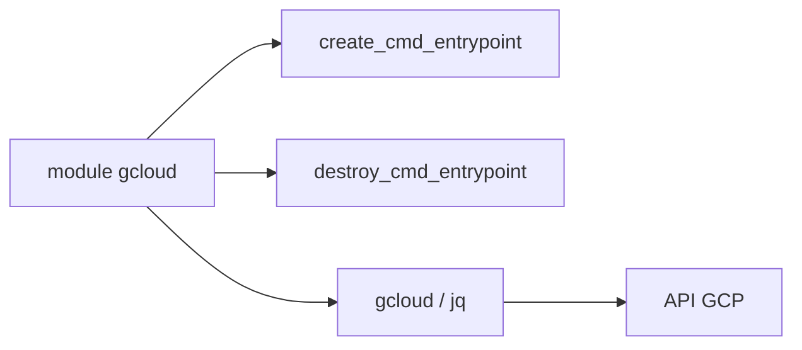

# terraform-google-modules/terraform-google-gcloud

> Module Terraform qui exécute gcloud, gsutil et jq dans un plan, pour ce que Terraform ne couvre pas.

## Le problème
Certaines fonctions GCP n'ont pas de ressource Terraform, ou on veut lancer une commande à chaque exécution.

## Ce que ça fait vraiment
Expose le SDK GCP dans des null resources et data sources externes : une commande à la création, une à la destruction, avec composants gcloud additionnels et jq inclus. Peut utiliser le gcloud du PATH ou le télécharger. Ne crée aucune ressource GCP lui-même.

## Comment c'est branché


## Essayer
```bash
# module "gcloud" { source = "terraform-google-modules/gcloud/google"
#   create_cmd_entrypoint = "gcloud"  create_cmd_body = "version" }
terraform init && terraform apply
```

## Coût et pièges
Il faut un compte de service avec clé et les bons rôles IAM, et curl. Les commandes shell échappent à l'état déclaratif de Terraform (idempotence à ta charge).

## Ce que ce n'est pas
Pas une abstraction GCP : c'est un échappatoire shell. Le README mentionne Terraform v0.12 et un skip_download décrit de façon confuse.

## Alternatives
Aucune alternative nommée dans le README.

## Pour toi
Surveiller : un dépannage utile, à n'utiliser que quand aucune ressource native n'existe.

