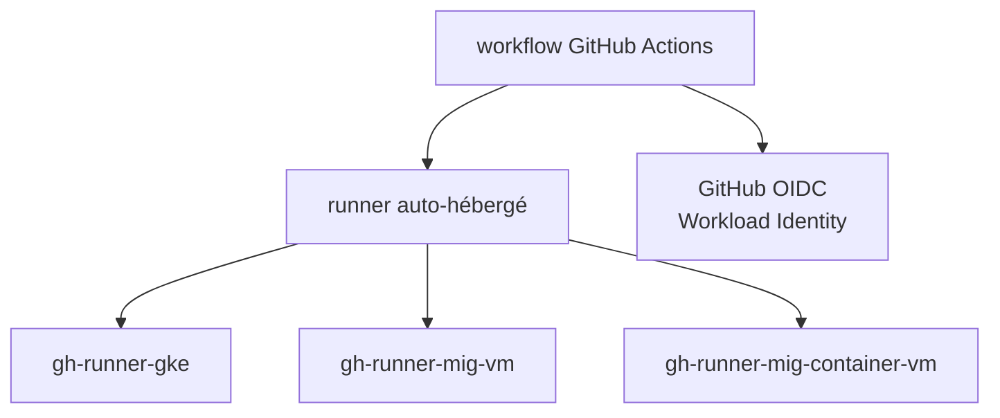

# terraform-google-modules/terraform-google-github-actions-runners

> Terraform modules to deploy self-hosted GitHub Actions runners on GCP, aimed at platform teams.

## The problem
GitHub-hosted runners are not always suitable (private network, dedicated machines). Setting them up by hand on GCP is repetitive.

## What it actually does
Four modules: `gh-runner-gke` (GKE with Actions Runner Controller), `gh-runner-mig-vm` (VM instance groups), `gh-runner-mig-container-vm` (container VM) and GitHub OIDC (Workload Identity to authenticate to GCP). Examples provided, including Docker and rootless.

## How it is wired
Simplified diagram based on the sheet, no diagram provided.

## Trying it
No command documented in the README: it points to the examples folders.

## Cost and gotchas
A GCP account and Terraform (v0.13 stated) are required. VMs and GKE clusters are billed by Google.

## What it is not
Not a CI service: it only provides the runners' infrastructure. The README is short and refers to the examples for any detail.

## Alternatives
Not documented in the README.

## For you
Worth watching: handy for GPU or private runners in an MLOps pipeline on GCP, useless outside that ecosystem.
