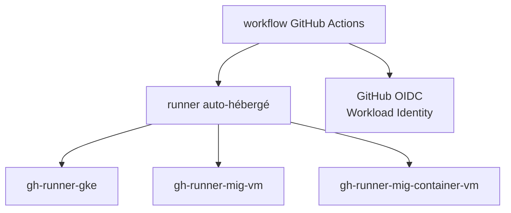

# terraform-google-modules/terraform-google-github-actions-runners

> Modules Terraform pour déployer des runners GitHub Actions auto-hébergés sur GCP, à l'attention des équipes plateforme.

## Le problème
Les runners hébergés par GitHub ne conviennent pas toujours (réseau privé, machines dédiées). Les monter à la main sur GCP est répétitif.

## Ce que ça fait vraiment
Quatre modules : `gh-runner-gke` (GKE avec Actions Runner Controller), `gh-runner-mig-vm` (groupes d'instances VM), `gh-runner-mig-container-vm` (VM conteneur) et GitHub OIDC (Workload Identity pour s'authentifier à GCP). Exemples fournis, dont Docker et rootless.

## Comment c'est branché
Schéma simplifié d'après la fiche, sans diagramme fourni.

## Essayer
Aucune commande documentée dans le README : renvoi vers les dossiers d'exemples.

## Coût et pièges
Compte GCP et Terraform (v0.13 annoncé) requis. Les VM et clusters GKE sont facturés par Google.

## Ce que ce n'est pas
Pas un service de CI : il ne fournit que l'infrastructure des runners. Le README est court et renvoie aux exemples pour tout détail.

## Alternatives
Non documenté dans le README.

## Pour toi
À surveiller : pratique pour des runners GPU ou privés dans un pipeline MLOps sur GCP, inutile hors de cet écosystème.

