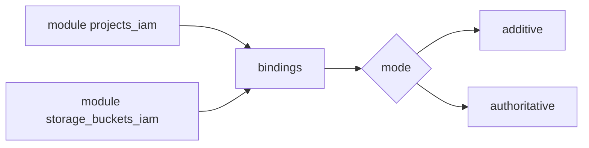

# terraform-google-modules/terraform-google-iam

> Terraform submodules to manage, without overwriting, the IAM roles of many Google Cloud resources.

## The problem
GCP IAM permissions are spread across projects, folders, buckets, topics, keys… and a manual or destructive change breaks access.

## What it actually does
About twenty submodules (projects, organizations, folders, service accounts, buckets, Pub/Sub, KMS, Secret Manager, DNS, subnets…). "Additive" mode by default (adds members), "authoritative" mode (removes any member not listed on the cited roles). Limits tied to `for_each`: dynamic values are restricted.

## How it is wired


## Trying it
```bash
# source = "terraform-google-modules/iam/google//modules/projects_iam"
terraform init && terraform plan
```

## Cost and gotchas
Free in itself. Authoritative mode deletes members added outside Terraform. You need a service account with IAM admin rights on the target resource.

## What it is not
Not a permissions audit tool. The README lists old provider versions (>= 0.13, 2.5) next to Terraform >= 1.3: inconsistent.

## Alternatives
No alternative named in the README.

## For you
Worth watching: useful for framing access to a data platform on GCP, but read up before enabling authoritative mode.
