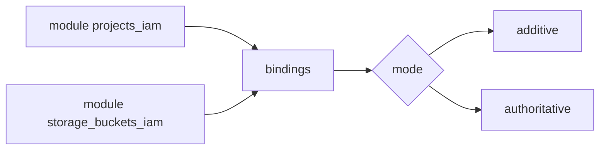

# terraform-google-modules/terraform-google-iam

> Sous-modules Terraform pour gérer sans écraser les rôles IAM de nombreuses ressources Google Cloud.

## Le problème
Les droits IAM GCP sont répartis sur projets, dossiers, buckets, topics, clés… et un changement manuel ou destructif casse les accès.

## Ce que ça fait vraiment
Une vingtaine de sous-modules (projets, organisations, dossiers, comptes de service, buckets, Pub/Sub, KMS, Secret Manager, DNS, subnets…). Mode « additive » par défaut (ajoute des membres), mode « authoritative » (retire tout membre non listé sur les rôles cités). Limites liées à `for_each` : valeurs dynamiques restreintes.

## Comment c'est branché


## Essayer
```bash
# source = "terraform-google-modules/iam/google//modules/projects_iam"
terraform init && terraform plan
```

## Coût et pièges
Gratuit en soi. Le mode authoritative supprime les membres ajoutés hors Terraform. Il faut un compte de service avec les droits d'administration IAM de la ressource visée.

## Ce que ce n'est pas
Pas un outil d'audit des droits. Le README indique des versions de provider anciennes (>= 0.13, 2.5) à côté de Terraform >= 1.3 : incohérent.

## Alternatives
Aucune alternative nommée dans le README.

## Pour toi
Surveiller : utile pour cadrer les accès d'une plateforme data sur GCP, mais à lire avant d'activer le mode authoritative.

