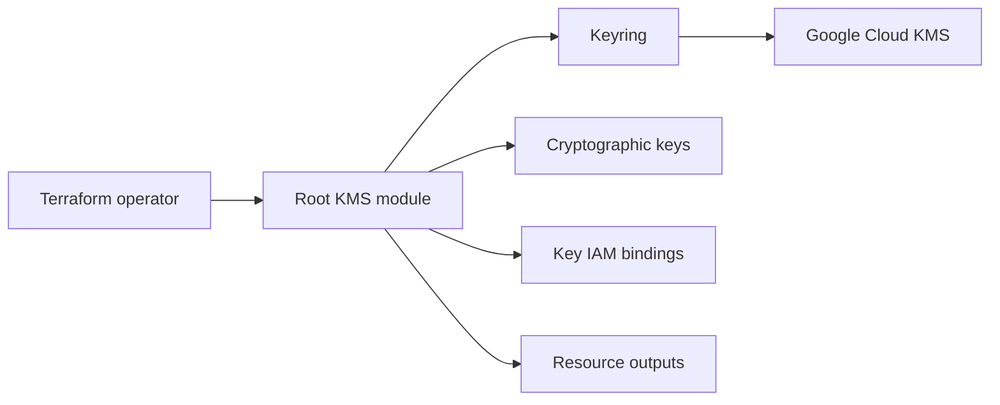

# terraform-google-modules/terraform-google-kms

> Terraform module to manage a Cloud KMS keyring, its keys and their IAM rights on GCP.

## The problem
Creating and sharing encryption keys with fine-grained rights is done poorly by hand.

## What it actually does
Creates a keyring, zero or more keys, and IAM bindings for owners, encrypters and decrypters per key. Default rotation of 90 days (7776000s), `prevent_destroy` enabled, protection levels SOFTWARE, HSM or EXTERNAL. An Autokey submodule exists (not detailed).

## How it is wired


## Trying it
```bash
# module "kms" { source = "terraform-google-modules/kms/google" ... }
terraform init && terraform apply
```

## Cost and gotchas
KMS keys are billed by GCP. Requires the `roles/cloudkms.admin` or `roles/owner` role and the cloudkms API enabled. Keys are not deleted immediately (destruction period).

## What it is not
Not a secrets vault. No guarantee on Autokey: implementation not verified.

## Alternatives
No alternative named in the README.

## For you
Watch: useful for encrypting sensitive datasets and models on GCP.
