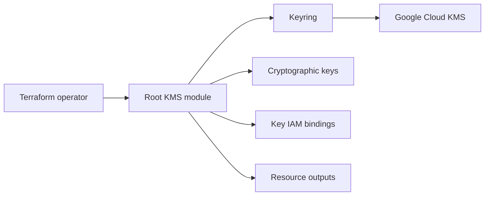

# terraform-google-modules/terraform-google-kms

> Module Terraform pour gérer un keyring Cloud KMS, ses clés et leurs droits IAM sur GCP.

## Le problème
Créer et partager des clés de chiffrement avec des droits fins se fait mal à la main.

## Ce que ça fait vraiment
Crée un keyring, zéro ou plusieurs clés, et des liaisons IAM pour propriétaires, chiffreurs et déchiffreurs par clé. Rotation par défaut de 90 jours (7776000s), `prevent_destroy` actif, niveaux de protection SOFTWARE, HSM ou EXTERNAL. Un sous-module Autokey existe (non détaillé).

## Comment c'est branché


## Essayer
```bash
# module "kms" { source = "terraform-google-modules/kms/google" ... }
terraform init && terraform apply
```

## Coût et pièges
Clés KMS facturées par GCP. Rôle `roles/cloudkms.admin` ou `roles/owner` et API cloudkms activée. Les clés ne se suppriment pas immédiatement (période de destruction).

## Ce que ce n'est pas
Pas un coffre à secrets. Aucune garantie sur Autokey : implémentation non vérifiée.

## Alternatives
Aucune alternative nommée dans le README.

## Pour toi
Surveiller : utile pour chiffrer datasets et modèles sensibles sur GCP.

