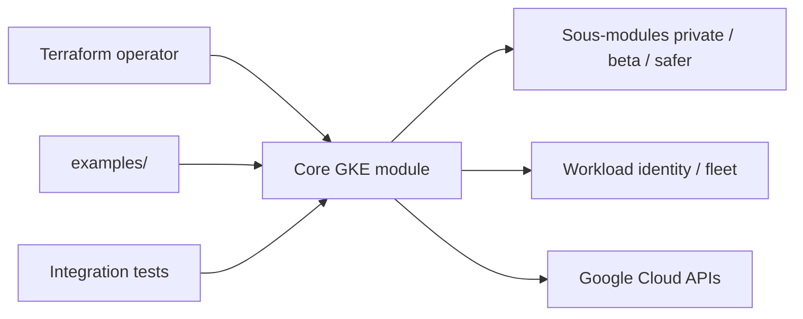

# terraform-google-modules/terraform-google-kubernetes-engine

> Terraform module to create and configure a GKE cluster with node pools, networking and add-ons.

## The problem
A well-configured GKE cluster requires dozens of parameters (network, IAM, node pools, network policy). By hand, it is repetitive and fragile.

## What it actually does
Creates the cluster, its node pools (GPU, spot, taints, labels), network policy enablement, the ip-masq-agent configmap and kube-dns if requested. Submodules for private clusters, beta, safer-cluster, fleet, workload identity. Hundreds of input variables, including the GPU accelerator per pool.

## How it is wired


## Trying it
```bash
terraform init
terraform plan
terraform apply
terraform destroy
```

## Cost and gotchas
GKE clusters and nodes (including GPU) are billed by Google. A service account with several roles (container.clusterAdmin, iam.serviceAccountAdmin…) and the Compute/Kubernetes Engine APIs must be enabled. The kubernetes provider must be declared explicitly.

## What it is not
Not an application deployment tool: it only creates the cluster. Changing some options (`regional`, `enable_tpu`) after creation is destructive.

## Alternatives
- The project-factory module from the same group to create GCP projects (cited in the README).

## For you
Adopt if you build GKE clusters for training/serving with GPUs: it is the standard Terraform route, with state to manage on the consumer side.
