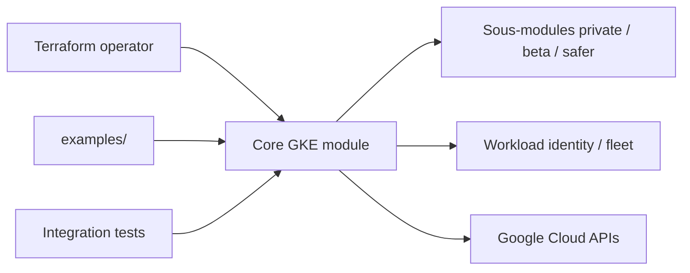

# terraform-google-modules/terraform-google-kubernetes-engine

> Module Terraform pour créer et configurer un cluster GKE avec node pools, réseau et add-ons.

## Le problème
Un cluster GKE bien configuré demande des dizaines de paramètres (réseau, IAM, node pools, politique réseau). À la main, c'est répétitif et fragile.

## Ce que ça fait vraiment
Crée le cluster, ses node pools (GPU, spot, taints, labels), l'activation de la network policy, le configmap ip-masq-agent et kube-dns si demandé. Sous-modules pour clusters privés, bêta, safer-cluster, fleet, workload identity. Des centaines de variables d'entrée, dont l'accélérateur GPU par pool.

## Comment c'est branché


## Essayer
```bash
terraform init
terraform plan
terraform apply
terraform destroy
```

## Coût et pièges
Les clusters GKE et nodes (dont GPU) sont facturés par Google. Compte de service avec plusieurs rôles (container.clusterAdmin, iam.serviceAccountAdmin…) et API Compute/Kubernetes Engine à activer. Le provider kubernetes doit être déclaré explicitement.

## Ce que ce n'est pas
Pas un outil de déploiement d'applications : il ne crée que le cluster. Changer certaines options (`regional`, `enable_tpu`) après création est destructif.

## Alternatives
- Le module project-factory du même groupe pour créer les projets GCP (cité dans le README).

## Pour toi
À adopter si tu montes des clusters GKE pour entraînement/serving avec GPU : c'est la voie Terraform standard, avec un état à gérer côté consommateur.

