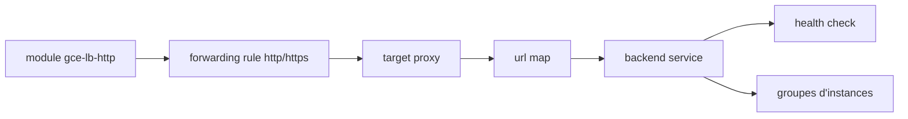

# terraform-google-modules/terraform-google-lb-http

> Terraform module that creates a global HTTP(S) load balancer on Google Cloud, for anyone managing their GCP infrastructure as code.

## The problem
Setting up a GCP global load balancer by hand (forwarding rules, proxy, URL map, certificates, health checks, firewall) is long and repetitive.

## What it actually does
The module creates the HTTP/HTTPS forwarding rules, the proxies, the default URL map, the backend services, the health checks and the associated firewall rules. It handles SSL certificates (provided or Google-managed), IPv4/IPv6, CDN, IAP, QUIC. Submodules cover dynamic backends (GKE) and serverless backends (Cloud Run, Functions, App Engine).

## How it is wired


## Trying it
```bash
# Pas de commande documentée : on déclare le module dans un .tf
# source  = "GoogleCloudPlatform/lb-http/google"
# puis les commandes Terraform habituelles
terraform init && terraform plan
```

## Cost and gotchas
The GCP resources created are billed to you; you need a GCP project and credentials. The README mixes several versions (current 12.0, example at ~> 9.0): check the version.

## What it is not
Not a TCP or internal load balancer (listed as types but the module covered is HTTP/S). Not usable outside GCP. Many parameters: the learning curve comes from the `backends` object.

## Alternatives
- The dynamic_backends and serverless_negs submodules of the same repository, if the backends are managed outside Terraform or are serverless.

## For you
Keep an eye on it: useful only if you deploy AI/MLOps services behind an LB on GCP, otherwise off topic.
