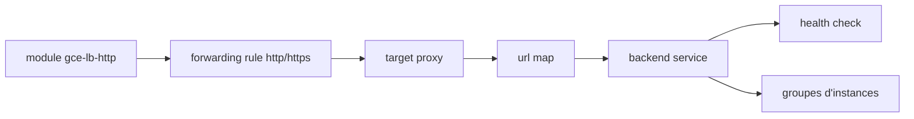

# terraform-google-modules/terraform-google-lb-http

> Module Terraform qui crée un load balancer HTTP(S) global sur Google Cloud, pour qui gère son infra GCP en code.

## Le problème
Monter à la main un load balancer global GCP (règles de forwarding, proxy, URL map, certificats, health checks, firewall) est long et répétitif.

## Ce que ça fait vraiment
Le module crée les règles de forwarding HTTP/HTTPS, les proxys, l'URL map par défaut, les services backend, les health checks et les règles firewall associées. Il gère les certificats SSL (fournis ou managés par Google), IPv4/IPv6, CDN, IAP, QUIC. Des sous-modules couvrent les backends dynamiques (GKE) et les backends serverless (Cloud Run, Functions, App Engine).

## Comment c'est branché


## Essayer
```bash
# Pas de commande documentée : on déclare le module dans un .tf
# source  = "GoogleCloudPlatform/lb-http/google"
# puis les commandes Terraform habituelles
terraform init && terraform plan
```

## Coût et pièges
Les ressources GCP créées sont facturées à ta charge ; il faut un projet GCP et des identifiants. Le README mélange plusieurs versions (courante 12.0, exemple en ~> 9.0) : vérifier la version.

## Ce que ce n'est pas
Pas un load balancer TCP ni interne (listés comme types mais le module traité est HTTP/S). Pas utilisable hors GCP. Beaucoup de paramètres : la courbe d'apprentissage vient de l'objet `backends`.

## Alternatives
- Les sous-modules dynamic_backends et serverless_negs du même dépôt, si les backends sont gérés hors Terraform ou serverless.

## Pour toi
Surveiller : utile seulement si tu déploies des services IA/MLOps derrière un LB sur GCP, sinon hors sujet.

