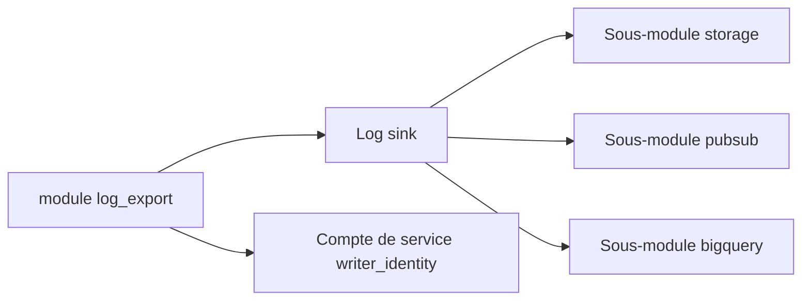

# terraform-google-modules/terraform-google-log-export

> Terraform module that exports Google Cloud logs to Storage, Pub/Sub or BigQuery; for platform teams.

## The problem
Configuring log sinks, their service account and the destination by hand, at every level of the GCP hierarchy.

## What it actually does
Creates an aggregated log sink at project, folder, organization or billing account level, with a writer service account. Submodules create the destination: Cloud Storage bucket, Pub/Sub topic or BigQuery dataset (partitioned tables possible). A filter and exclusions limit what is sent.

## How it is wired
Simplified diagram based on the sheet, no diagram provided.


## Trying it
```hcl
module "log_export" {
  source                 = "terraform-google-modules/log-export/google"
  version                = "~> 10.0"
  destination_uri        = "${module.destination.destination_uri}"
  filter                 = "severity >= ERROR"
  log_sink_name          = "storage_example_logsink"
  parent_resource_id     = "sample-project"
  parent_resource_type   = "project"
  unique_writer_identity = true
}
```

## Cost and gotchas
GCP account and service account with several roles (`logging.configWriter`, `storage.admin`, etc.) and enabled APIs. Storage and BigQuery are billed by Google. The README is inconsistent about the Terraform version (1.3+ then 0.12.x).

## What it is not
Not a log analysis tool: it only routes. It only covers GCP.

## Alternatives
None named in the README.

## For you
Watch: healthy building block for centralizing GCP logs into BigQuery, useful only if your MLOps pipelines run on Google Cloud.
