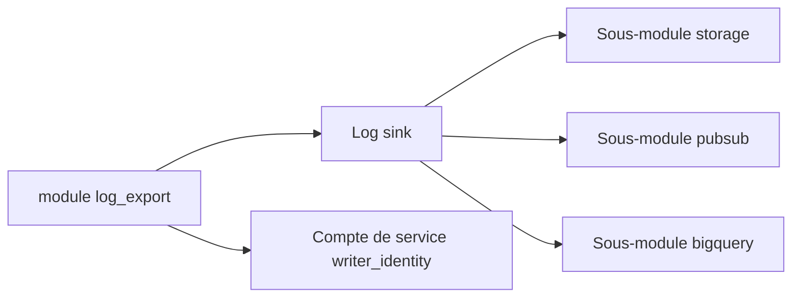

# terraform-google-modules/terraform-google-log-export

> Module Terraform qui exporte les logs Google Cloud vers Storage, Pub/Sub ou BigQuery ; pour équipes plateforme.

## Le problème
Configurer à la main des sinks de logs, leur compte de service et la destination, à chaque niveau de la hiérarchie GCP.

## Ce que ça fait vraiment
Crée un sink de logs agrégé au niveau projet, dossier, organisation ou compte de facturation, avec un compte de service d'écriture. Des sous-modules créent la destination : bucket Cloud Storage, topic Pub/Sub ou dataset BigQuery (tables partitionnées possibles). Un filtre et des exclusions limitent ce qui part.

## Comment c'est branché
Schéma simplifié d'après la fiche, sans diagramme fourni.


## Essayer
```hcl
module "log_export" {
  source                 = "terraform-google-modules/log-export/google"
  version                = "~> 10.0"
  destination_uri        = "${module.destination.destination_uri}"
  filter                 = "severity >= ERROR"
  log_sink_name          = "storage_example_logsink"
  parent_resource_id     = "sample-project"
  parent_resource_type   = "project"
  unique_writer_identity = true
}
```

## Coût et pièges
Compte GCP et compte de service avec plusieurs rôles (`logging.configWriter`, `storage.admin`, etc.) et APIs activées. Le stockage et BigQuery sont facturés par Google. Le README est incohérent sur la version de Terraform (1.3+ puis 0.12.x).

## Ce que ce n'est pas
Pas un outil d'analyse de logs : il ne fait qu'acheminer. Il ne couvre que GCP.

## Alternatives
Aucune nommée dans le README.

## Pour toi
Surveiller : brique saine pour centraliser des logs GCP vers BigQuery, utile seulement si tes pipelines MLOps tournent sur Google Cloud.

