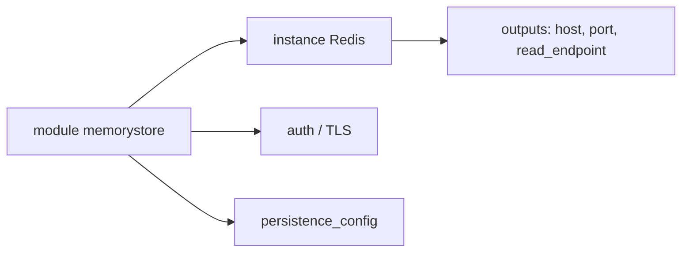

# terraform-google-modules/terraform-google-memorystore

> Terraform module for creating a Google Memorystore Redis instance, with Memcache, Redis Cluster and Valkey submodules.

## The problem
Provisioning a managed cache (HA, encryption, networking, persistence) by hand is not reproducible.

## What it actually does
Creates a Memorystore Redis instance: memory size, STANDARD_HA tier by default, replicas, auth, TLS, RDB persistence, maintenance, managed key. Other engines go through submodules.

## How it is wired


## Trying it
```bash
# module "memorystore" { source = "terraform-google-modules/memorystore/google"
#   name = "memorystore" project_id = "memorystore" memory_size_gb = "1" }
terraform init && terraform apply
```

## Cost and gotchas
Memorystore billing, especially in STANDARD_HA. The `roles/redis.admin` role and the redis API enabled. Contradictory versions in the README (14.0 vs ~> 16.4).

## What it is not
Not a Redis client, only provisioning.

## Alternatives
No alternative named in the README.

## For you
Worth watching: useful for a feature or inference cache on GCP.
