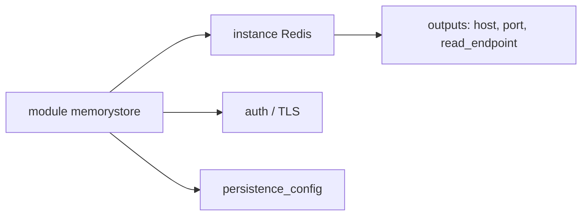

# terraform-google-modules/terraform-google-memorystore

> Module Terraform pour créer une instance Redis Google Memorystore, avec sous-modules Memcache, Redis Cluster et Valkey.

## Le problème
Provisionner un cache géré (HA, chiffrement, réseau, persistance) à la main n'est pas reproductible.

## Ce que ça fait vraiment
Crée une instance Memorystore Redis : taille mémoire, niveau STANDARD_HA par défaut, réplicas, auth, TLS, persistance RDB, maintenance, clé gérée. Les autres moteurs passent par des sous-modules.

## Comment c'est branché


## Essayer
```bash
# module "memorystore" { source = "terraform-google-modules/memorystore/google"
#   name = "memorystore" project_id = "memorystore" memory_size_gb = "1" }
terraform init && terraform apply
```

## Coût et pièges
Facturation Memorystore, surtout en STANDARD_HA. Rôle `roles/redis.admin` et API redis activée. Versions contradictoires dans le README (14.0 vs ~> 16.4).

## Ce que ce n'est pas
Pas un client Redis, seulement du provisioning.

## Alternatives
Aucune alternative nommée dans le README.

## Pour toi
Surveiller : utile pour un cache de features ou d'inférence sur GCP.

