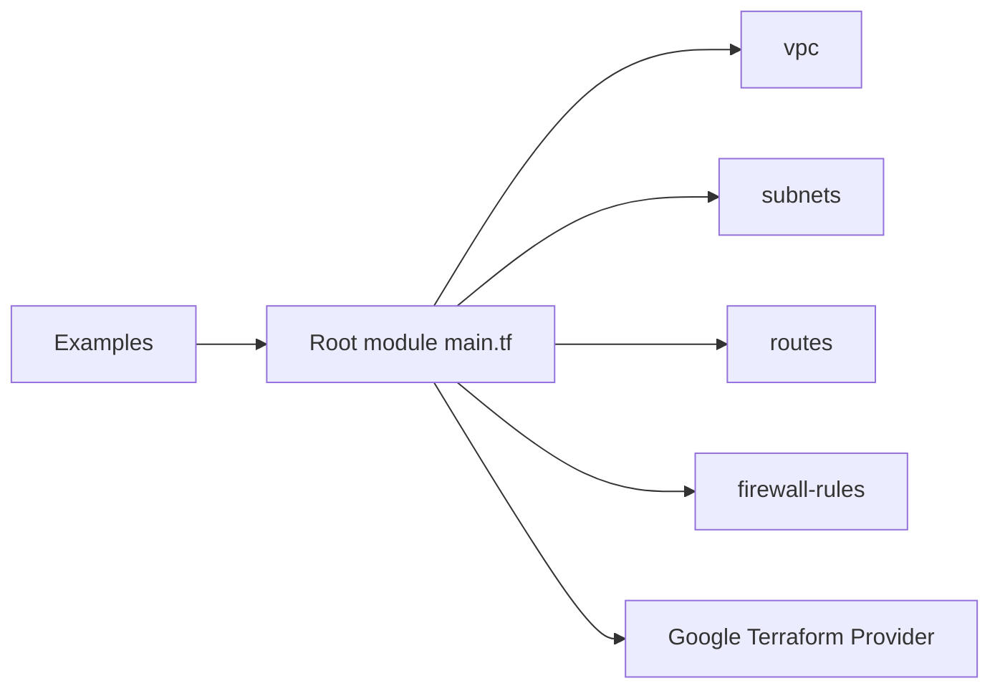

# terraform-google-modules/terraform-google-network

> Terraform module that creates a GCP VPC with subnets, routes and firewall rules.

## The problem
Describing a complete GCP network (VPC, subnets, secondary ranges, routes, firewall) as separate resources is verbose.

## What it actually does
The module creates a VPC, its subnets with secondary ranges and flow logs, routes, firewall rules, network and hierarchical firewall policies, a serverless VPC access connector and Network Connectivity Center. Each feature also has a submodule. The repository contains examples, Go integration tests and CI pipelines.

## How it is wired


## Trying it
```hcl
module "vpc" {
  source  = "terraform-google-modules/network/google"
  version = "~> 18.3"
  project_id   = "<PROJECT ID>"
  network_name = "example-vpc"
  routing_mode = "GLOBAL"
}
```
```bash
terraform init
terraform plan
terraform apply
```

## Cost and gotchas
Terraform 1.3 or later. Service account with the `compute.networkAdmin` role and the Compute Engine API enabled. GCP network costs are on you. Several input tables in the README (types, required) are inconsistent with the code: rely on the variables.

## What it is not
Not a network monitoring tool: it only provisions. The README does not say who maintains the module.

## Alternatives
The README names no alternative.

## For you
Watch: useful if your AI workloads run on GCP and you want a reproducible network, otherwise of no interest.
