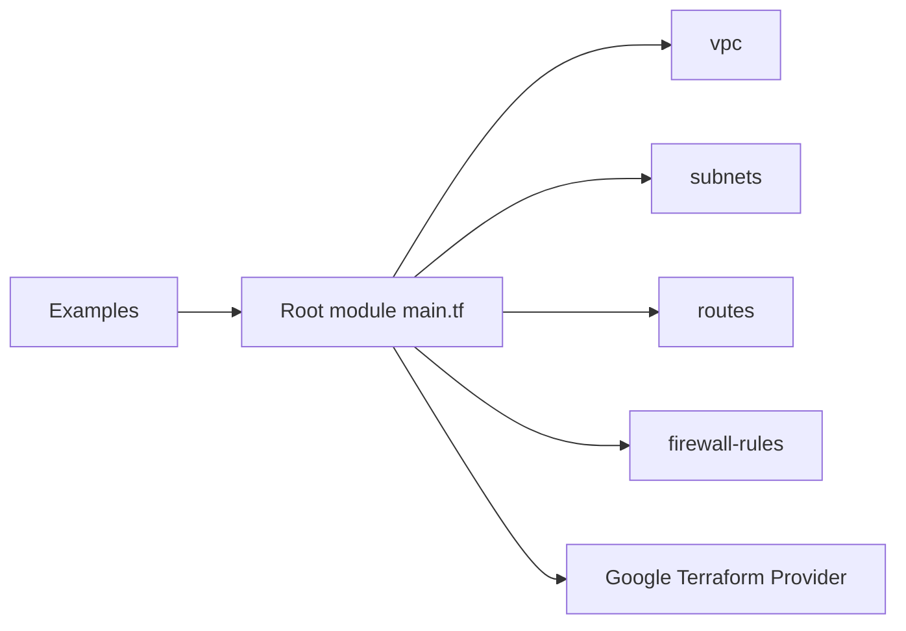

# terraform-google-modules/terraform-google-network

> Module Terraform qui crée un VPC GCP avec sous-réseaux, routes et règles de pare-feu.

## Le problème
Décrire un réseau GCP complet (VPC, sous-réseaux, plages secondaires, routes, pare-feu) en ressources séparées est verbeux.

## Ce que ça fait vraiment
Le module crée un VPC, ses sous-réseaux avec plages secondaires et logs de flux, les routes, les règles de pare-feu, les politiques de pare-feu réseau et hiérarchiques, un connecteur d'accès VPC serverless et Network Connectivity Center. Chaque fonction a aussi un sous-module. Le dépôt contient exemples, tests d'intégration en Go et pipelines CI.

## Comment c'est branché


## Essayer
```hcl
module "vpc" {
  source  = "terraform-google-modules/network/google"
  version = "~> 18.3"
  project_id   = "<PROJECT ID>"
  network_name = "example-vpc"
  routing_mode = "GLOBAL"
}
```
```bash
terraform init
terraform plan
terraform apply
```

## Coût et pièges
Terraform 1.3 ou plus. Compte de service avec le rôle `compute.networkAdmin` et l'API Compute Engine activée. Les coûts réseau GCP sont à ta charge. Plusieurs tableaux d'entrées du README (types, obligatoires) sont incohérents avec le code : se fier aux variables.

## Ce que ce n'est pas
Pas un outil de supervision réseau : il provisionne uniquement. Le README ne précise pas qui maintient le module.

## Alternatives
Le README ne nomme pas d'alternative.

## Pour toi
Surveiller : utile si tes charges d'IA tournent sur GCP et que tu veux un réseau reproductible, sinon sans intérêt.

