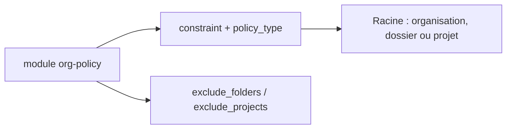

# terraform-google-modules/terraform-google-org-policy

> Terraform module to set GCP organization policies with folder or project exclusions.

## The problem
Applying an organization constraint to a whole GCP tree, except for a few projects, is tedious to write by hand.

## What it actually does
Sets a boolean or list policy (allow, deny, enforce) at the root, organization, folder or project level. `exclude_folders` and `exclude_projects` lists disable it on subsets. Allow/deny lists require their length to be given explicitly (a workaround for a Terraform default).

## How it is wired
Simplified diagram based on the sheet, no diagram provided.


## Trying it
```hcl
module "org-policy" {
  source            = "terraform-google-modules/org-policy/google"
  version           = "~> 7.0"
  policy_for        = "organization"
  constraint        = "constraints/serviceuser.services"
  policy_type       = "list"
  organization_id   = "123456789"
  enforce           = true
}
```

## Cost and gotchas
The service account must have the Organization Policy Administrator role. A bad policy at the root can block services across the whole organization.

## What it is not
Not a compliance or audit tool: it applies policies, it does not verify them. GCP only.

## Alternatives
None named in the README.

## For you
Watch: useful if you manage governance of a GCP organization hosting your AI projects, otherwise off topic.
