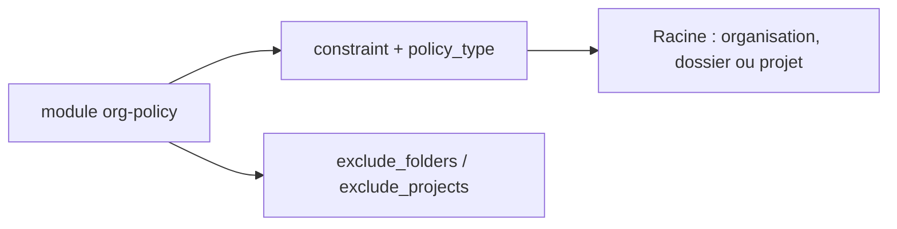

# terraform-google-modules/terraform-google-org-policy

> Module Terraform pour poser des politiques d'organisation GCP avec exclusions par dossier ou projet.

## Le problème
Appliquer une contrainte d'organisation à tout un arbre GCP, sauf quelques projets, est pénible à écrire à la main.

## Ce que ça fait vraiment
Pose une politique booléenne ou de liste (allow, deny, enforce) à la racine, organisation, dossier ou projet. Des listes `exclude_folders` et `exclude_projects` la désactivent sur des sous-ensembles. Les listes allow/deny demandent leur longueur explicite (contournement d'un défaut de Terraform).

## Comment c'est branché
Schéma simplifié d'après la fiche, sans diagramme fourni.


## Essayer
```hcl
module "org-policy" {
  source            = "terraform-google-modules/org-policy/google"
  version           = "~> 7.0"
  policy_for        = "organization"
  constraint        = "constraints/serviceuser.services"
  policy_type       = "list"
  organization_id   = "123456789"
  enforce           = true
}
```

## Coût et pièges
Le compte de service doit avoir le rôle Organization Policy Administrator. Une mauvaise politique à la racine peut bloquer des services dans toute l'organisation.

## Ce que ce n'est pas
Pas un outil de conformité ni d'audit : il applique des politiques, il ne les vérifie pas. GCP uniquement.

## Alternatives
Aucune nommée dans le README.

## Pour toi
Surveiller : utile si tu gères la gouvernance d'une organisation GCP qui héberge tes projets IA, sinon hors sujet.

