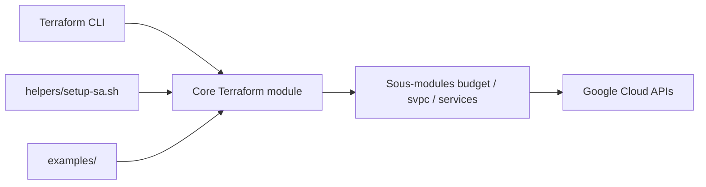

# terraform-google-modules/terraform-google-project-factory

> Terraform module to create Google Cloud projects with Shared VPC, IAM, service accounts and APIs ready.

## The problem
Creating consistent GCP projects (billing, shared network, permissions, APIs) by hand produces discrepancies between teams.

## What it actually does
Creates the project, attaches it to the shared VPC, deletes or disables the default service account, creates a new account, links billing, grants access to a group, enables APIs, deletes the default network, enables usage reporting, and can create a GCS bucket. Submodules: budget, quotas, essential contacts, App Engine, G Suite. A script checks preconditions.

## How it is wired


## Trying it
```bash
./helpers/setup-sa.sh -o <organization id> -p <project id> [-b <billing account id>]
./helpers/preconditions/preconditions.py --credentials_path "./credentials.json" --billing_account 000000-000000-000000 --org_id 000000000000
```
Usage: the Terraform `module "project-factory"` block from the README.

## Cost and gotchas
Service account with heavy organization roles (projectCreator, billing.user, xpnAdmin...). Deleting the default account can break App Engine or Cloud Scheduler.

## What it is not
Not a tool for managing resources inside the project: it only creates the project and its foundation. Known bug when moving a project from the organization to a folder.

## Alternatives
- The gsuite_enabled module from the same repository for groups (cited).

## For you
Worth watching: useful if your data team manages several GCP projects; otherwise a single project is created by hand.
